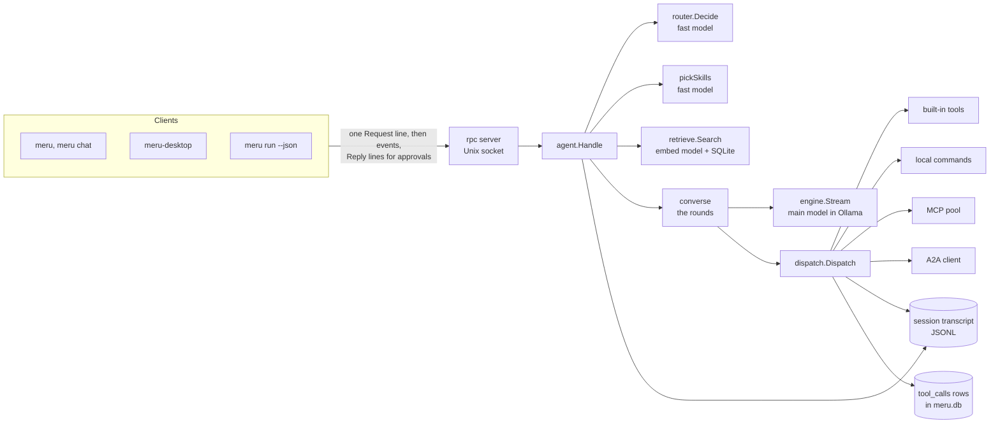
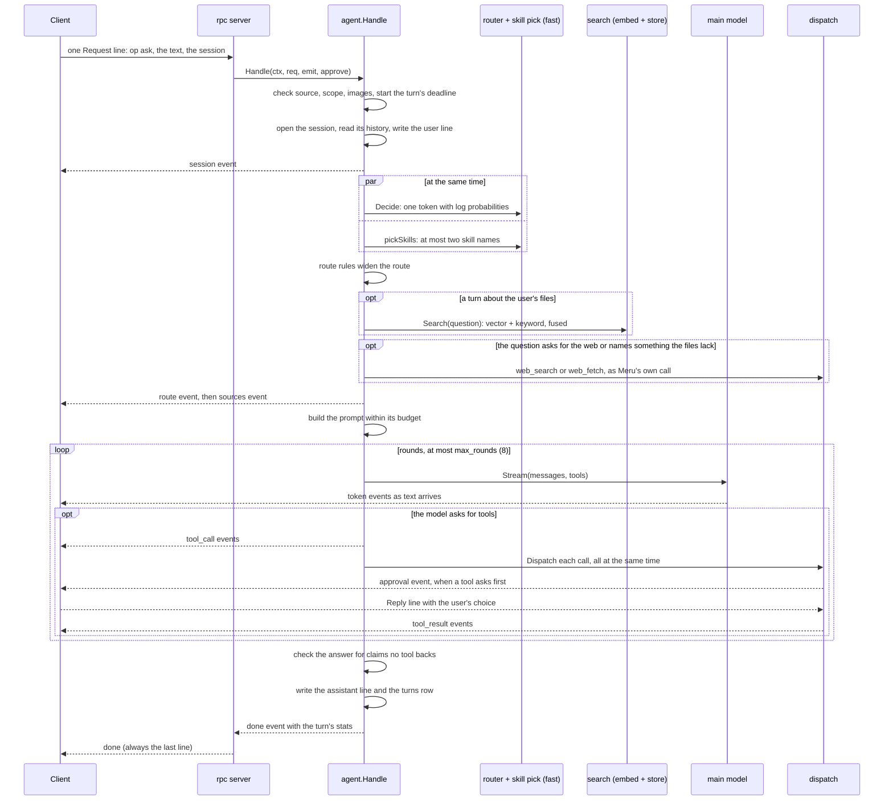
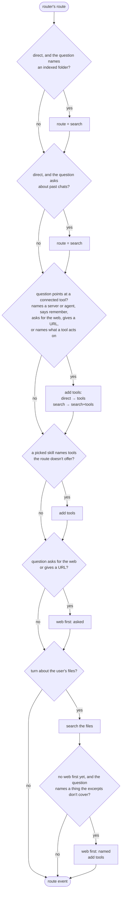
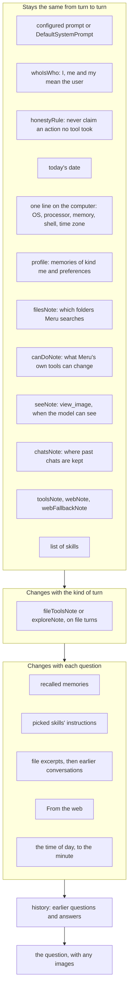
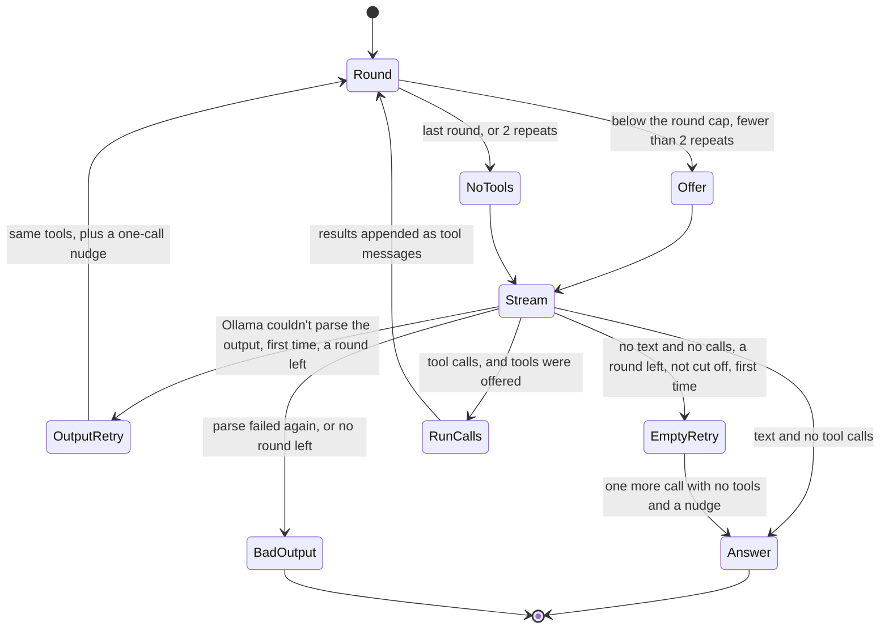
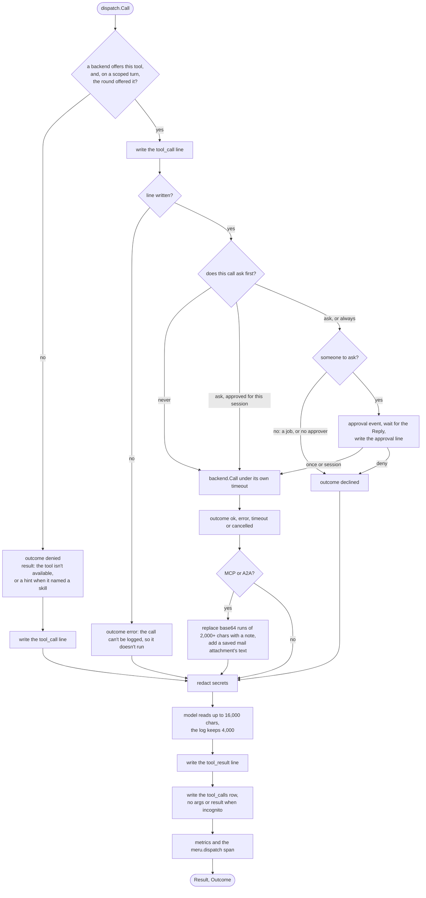
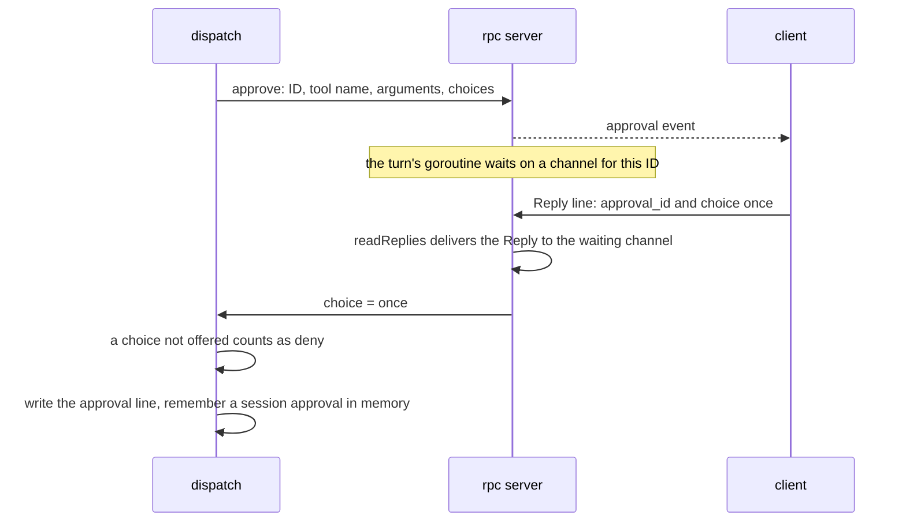

# Meru's agent harness, level 300

This page describes the harness at the centre of `merud`: the code that takes one
question, decides where to look, builds a prompt, runs the model in a loop of tool
calls, checks the answer and keeps a record of everything. It is written for people
who build Meru, and it is detailed enough to change the code from. Every number on
this page comes from the code as of v0.4.15; the file and constant that hold it are
named beside it.

[ARCHITECTURE.md](../../ARCHITECTURE.md) is the design for the whole of Meru, and
its section [merud as an agent harness](../../ARCHITECTURE.md#merud-as-an-agent-harness)
introduces this one. This page goes further into one part: a turn, from the moment
a question reaches `merud` to the moment the answer's last event leaves it.

## Words this page uses

Later terms use earlier ones, so read them in order.

- **Model.** A language model that Ollama runs on this machine. Meru gives models
  three jobs, called **tiers**: `fast` picks a route and the skills, `main` writes
  the answer and chooses tools, and `embed` turns text and images into vectors for
  search. On the default `lite` profile one small model, MiniCPM5-2B, fills both
  `fast` and `main`.
- **Harness.** Everything around the model that isn't its weights: the prompt, the
  tools it may call, the loop that runs those calls, the record of what happened,
  and the checks on the answer. "Agent = model + harness."
- **Turn.** One question and its answer. The harness runs one turn per `ask`
  request.
- **Round.** One call to the `main` model inside a turn. A round either answers in
  text or asks for tools. A turn with tool calls has several rounds; one without has
  one.
- **Session.** A conversation: a run of turns that share a history. Each session is
  one JSONL file, the **transcript**, under `~/.meru/sessions`.
- **Route.** Where a turn looks for its answer. There are four: `direct` (the model
  alone), `search` (search the user's files first), `tools` (offer tools), and
  `search+tools` (both). The **router** picks one.
- **Scope.** Where the user lets a turn look, picked in the desktop app or chat
  client: `auto` (the router decides), `files`, `mail`, `web` or `talk`. Any scope
  but `auto` skips the router.
- **Tool.** Something the model may call: a built-in tool inside `merud`, a local
  command declared in config, a tool on an MCP (Model Context Protocol) server, or a
  skill of an A2A (Agent2Agent) agent.
- **Backend.** The code that owns one kind of tool. There are four backends:
  built-in tools, local commands, the MCP pool and the A2A client.
- **Dispatch.** The one function every tool call goes through, in
  `internal/dispatch`. It checks the allowlist, asks the user when a tool needs a
  yes, runs the call on its backend, and records it.
- **Skill.** A Markdown file of instructions for one kind of task, such as
  `writing` or `web-research`. A skill is never a tool; it is text that joins the
  prompt when a turn needs it.
- **Event.** One line of JSON that `merud` sends back to the client during a turn:
  `token` for a piece of the answer, `tool_call`, `approval`, `sources`, `done` and
  others.

## Two layers

The code in `internal/agent` holds two layers that share one function, `Handle`.

| Layer | What it does | Where it lives |
| --- | --- | --- |
| Harness core | Runs any model in a loop of tool calls: the rounds, `dispatch`, the backends, skills, the transcript, the context budget, tracing | `agent/tools.go`, `agent/skills.go`, `agent/budget.go`, `dispatch`, `mcp`, `a2a`, `commands`, `builtin`, `transcript`, `obs` |
| Meru the assistant | Decides where to look and catches a small model's mistakes: the router and its override rules, search before the answer, memory recall, past chats, web first, and the checks on the answer | `router`, `agent/toolnouns.go`, `agent/webfirst.go`, `agent/webnotes.go`, `agent/honest.go`, `agent/notools.go`, `agent/recall.go`, `agent/earlier.go`, `retrieve` |

A script can drive the harness through `meru run --json "question"`, which writes
each event as one JSON line. Nothing in the loop knows which client asked: the
terminal, the desktop app and a script all send the same request and read the same
events.



*Figure 1. The parts a turn touches. A client sends one request over the Unix
socket. `Handle` asks the router and the skill pick, searches the user's files, and
hands the prompt to `converse`, which calls the `main` model round after round. Every
tool call leaves through `dispatch`, which reaches four backends and records each call
in the transcript and in the `tool_calls` table. The engine is the only door to a
model, and `dispatch` is the only door to a tool.*

## A turn at a glance



*Figure 2. One turn. The router and the skill pick run side by side on the `fast`
model. A search of the user's files, and sometimes a web search, run before the
`main` model sees the question. The `main` model then runs in rounds: each round
streams text to the client or asks for tools, and `dispatch` runs those tools,
asking the user over the same socket when a tool needs a yes. After the last round
the harness checks the answer, writes the record, and sends `done`.*

The rest of this page follows that diagram from top to bottom.

## 1. The request arrives

A client connects to `~/.meru/merud.sock`, a Unix socket only the user can open
(mode `0600`, inside the `0700` folder `~/.meru`). It writes one line of JSON, an
`rpc.Request`. For a question the fields that matter are:

| Field | Meaning |
| --- | --- |
| `op` | `"ask"` |
| `text` | the question |
| `session` | the session to continue; empty starts a new one |
| `source` | `cli`, `tui`, `desktop` or `job`; empty means `cli` |
| `scope` | `auto`, `files`, `mail`, `web` or `talk`; empty means `auto` |
| `images` | up to 5 paths of pictures the user attached (`rpc.MaxImages`) |
| `incognito` | true starts a chat that writes no transcript |

A spoken question arrives the same way, as text. Meru.app's microphone sends the
recording first, in a separate `transcribe` request that whisper.cpp's server on
loopback turns into words, and the user reads and fixes those words in the box
before pressing Send. Only then does an `ask` start a turn. The harness never
sees the audio, and the answer model never hears it (see
[ARCHITECTURE.md, Speech to text](../../ARCHITECTURE.md#speech-to-text)).

The rpc server (`internal/rpc/server.go`) reads the line, opens a span named
`rpc.request`, and calls the handler with three things: the request, an `emit`
function that writes one event back, and an `approve` function that asks the user
about a tool call and waits for the answer. `emit` takes a lock for each write,
because the tool calls of one round send events from several goroutines at once.

While `merud` starts, a gate stands in front of the handler. Until Ollama answers
and the `fast` and `embed` models load, a question waits, or gets a sentence that
says why Meru can't answer yet, such as Ollama not running or being older than
0.40.5.

`Handle` (`internal/agent/agent.go`) then checks the request before it does any
work. An empty question, an unknown source or an unknown scope fails the turn at
once: source and scope go into metrics and spans, which accept only a fixed set of
values. When the question carries images, `loadImages` reads each one through the
built-in tools' image reader, which refuses anything outside the uploads folder, a
symbolic link, a missing file, or a file that isn't an image.

### The deadline and cancellation

A turn gets two contexts. `ctx` ends when the client hangs up. `tctx` ends when
`ctx` does or when `[agent] turn_timeout` runs out (default `"5m"`, the constant
`defaultTurnTimeout`), whichever comes first. Every model call and tool call in the
turn runs under `tctx`, so a deadline stops Ollama's request and every tool still
running. Comparing the two tells the cases apart: when `tctx` ended and `ctx`
didn't, the turn ran out of time and still answers with what it has; when `ctx`
ended, the user left, and the turn writes no answer at all.

The rpc server watches the connection for this. A goroutine, `readReplies`, reads
the client's later lines (approval replies) and cancels the turn when the
connection closes, so Ctrl-C in `meru` or closing the desktop window stops the
model mid-sentence.

## 2. The session and its history

`openSession` opens the transcript named in the request, creates a new one, or
starts an incognito chat. An incognito chat keeps its lines in memory only, under an
ID such as `incognito-7f3a09bc` that no file-handling code accepts. `merud` holds at
most 16 incognito chats (`maxIncognito`) and drops one after an hour without a
question (`incognitoIdle`).

`History` (`internal/transcript/transcript.go`) then reads the last
`[agent] history_turns` turns (default 10) as model messages. It builds them with
care:

- **Questions and answers only.** It pairs each user line with the assistant line
  that answered it. Tool calls and their raw results stay out: the answer that used
  a result already carries what mattered, and a raw result can run to thousands of
  tokens.
- **A question with no answer drops out.** When a turn failed or the user
  cancelled it, its question has no answer line, and the model never sees two
  questions in a row.
- **Notices travel with their answer.** When an answer carried a warning, such as
  "Meru didn't run any tool for this answer", the warning follows the answer in
  square brackets, so the next turn doesn't build on a false claim.
- **Web notes travel too.** When a turn read the web, its answer line kept up to 5
  short notes of what the pages said (`maxWebNotes`, at most 1,500 characters,
  `maxWebNoteChars`). They follow the answer as `[from the web: title url — gist]`.
  A real session showed why: a turn read a product's page and answered well, and
  the next three turns, with only the questions and answers in their history, made
  up the product's features.
- **Images become names.** A question that carried pictures gets a note per
  picture, `[image: receipt.jpg]`, and never the bytes. Each picture costs the model
  hundreds of tokens, and the answer that looked at it sits in the history already.

The turn then emits the `session` event, so the client knows the session ID before
anything else, and writes the **user line** to the transcript. The user line comes
first on purpose: whatever happens later, the question is on record. It carries the
time the turn started, so a usage row rebuilt from the transcript gets the same
time as the row written live.

The turn also keeps `t.question`: this question and every earlier question of the
user's in the history, one per line, and nothing else. No excerpt, memory or tool
result goes in. `web_fetch` reads it to tell a URL the user typed from one the model
invented or copied from a web page.

## 3. Deciding where to look

### Three ways in

`respond` picks one of three paths.

1. **The question has images.** First, when the index holds images, `findSimilar`
   embeds the first picture and finds the 8 indexed images nearest to it
   (`similarCount`), with no model call. Then `checkVision` asks Ollama whether the
   `main` model lists the `vision` capability. When it doesn't, no model runs at
   all: the turn answers with the list of similar images, or with a sentence that
   the model can't look at pictures, and suggests a model set from the user's own
   config that can. When it does, the turn goes on through the scoped path below,
   because the router's `fast` model reads text only and can't judge a picture.
2. **The scope isn't `auto`.** The user said where to look, so `respondScoped`
   (`internal/agent/scope.go`) skips the router and every rule that widens a route.
   A scope is a promise about what the turn may touch: "Just talk" must never reach
   a tool.
3. **Auto.** The router decides, and the rules below adjust its choice.

### The router and the skill pick, side by side

`routeAndPick` (`internal/agent/skills.go`) starts two calls to the `fast` model at
once in an `errgroup`, because neither needs the other. The turn waits for the
slower one.

**The router** (`internal/router`, function `Decide`) treats the route as a
classification. A small model asked to write its choice as JSON writes broken JSON,
invents a fifth route, or picks wrong with no sign it was unsure. So the prompt lists
four lettered options, A for direct, B for search, C for tools and D for both, each
with two examples, the user's indexed folders and the tools they have connected,
then the history (all `history_turns` of it, with no character budget) and the
question, and ends with `Answer: `. `merud` asks Ollama for
exactly one token with log probabilities (`num_predict = 1`, `top_logprobs = 20`),
and thinking off, since a thinking model would spend its one token starting to
reason.

The router keeps the alternatives whose text is one of the four letters, adding up
variants such as " A" and "a". It divides each log probability by a fitted
temperature (1.25), turns it back into a probability, and scales the four so they
sum to 1. The most likely letter wins, and its
probability is the confidence. When the confidence falls below `min_confidence`
(0.45), or fewer than two letters came back, the router takes the fallback,
`search+tools`: the one route that can't leave a turn short of context. The router
never fails a turn for an unclear answer. It returns the fallback with an outcome of
`low_confidence` or `degraded`, and the route event carries `Fallback: true` so the
client can mark it.

**The skill pick** (`pickSkills`) sends the `fast` model the list of skills, each as
`- name: description`, and asks for the names the question needs, at most 2
(`maxPicked`), or `none`. It caps the answer at 20 tokens (`pickMaxTokens`), sets
the temperature to 0 and turns thinking off. `parsePick` reads the names out of the
text with no JSON: it keeps each word that names a real skill, drops repeats, and
stops at two. A failed pick logs a warning and the turn goes on with no skills; only
a failed route can fail the turn.

### The rules that adjust the route

The router reads one token. It can't know that "meru" in "what database does meru
use?" is the user's own project, or that "email" means the Gmail tools. Code in
`respond` corrects that, in this order. Each rule only adds: none of them takes a
search or a tool away.



*Figure 3. The route rules, in the order `respond` applies them. The router's choice
enters at the top. A question that names an indexed folder, or asks about past
chats, moves from direct to search. A question that points at a connected tool, or
whose picked skill needs tools, gains them. A question that asks for the web, or
gives a URL, goes to the web before the model's first round. After the search of
the user's files, a question that names something the files don't cover goes to the
web too. Only then does the client learn the route.*

1. **A folder by name.** When the route is `direct` and the question holds the last
   part of an indexed folder's path as a whole word, such as `meru` for
   `~/repos/meru`, the route becomes `search` (`namesFolder`). Names under three
   letters don't count. The router sent "what database does Meru use to store its
   index?" to `direct` at 0.621, and the model made up an answer; a wrong guess
   costs one search of about 50 ms.
2. **Past chats.** When the route is `direct` and the question asks about earlier
   conversations ("what were my previous conversations about?"), it becomes
   `search`, which offers the recalled sessions and the file tools that read the
   transcripts (`aboutPastChats`).
3. **A connected tool.** `toolTarget` (`internal/agent/toolnouns.go`) looks for six
   signs that the question points at a tool: it names an MCP server or A2A agent
   ("obsidian"), holds the word "remember", names Apple Notes ("apple notes" or
   "notes app"), asks for the web in a phrase such as
   "search the web" or "look it up", gives an `http` or `https` URL, or holds a word
   that matches a noun from a connected tool's name ("email" matches `gmail`
   because both end in "mail"). Any sign adds tools: `direct` becomes `tools`, and
   `search` becomes `search+tools` (`withTools`).
4. **A skill that needs tools.** `skillTools` reads each picked skill's
   `allowed-tools` key. A skill brings only tools config already allows; a skill
   whose tools are all off leaves the turn, because its steps would tell the model
   to call a tool it doesn't have. When a picked skill needs a tool the route lacks,
   the route gains tools. A small model told "search first with web_search" and
   offered only `datetime` once called `datetime` eight times in a row.
5. **Web first, asked.** A question that asks for the web, or gives a URL, goes to
   the web before the model's first round (see section 4).
6. **Web first, named.** After the search of the files, a question that names a
   thing, such as a product, and whose excerpts don't mention it, goes to the web
   too, and the route gains tools.

`aboutFiles` decides whether a turn is about the user's files: `search` and
`search+tools` always are, `tools` is unless the question points at a connected
tool, and `direct` never is. One rule decides two things: a file turn searches
first, and a file turn gets the note on the file tools.

## 4. Before the first round

### Search first

`searchesFirst` is true on a file turn when search is on and `[index] retrieval` is
`"auto"`, the default. With `"agentic"` no turn searches first; the model searches
for itself with `search_files`, `grep`, `list_folder` and `read_file`.

No model rewrites the query. `searchQuery` uses the question as typed when it holds
at least three words that aren't filler (`standaloneWords`). A shorter question is a
follow-up, such as "and the one after that?", and gets the session's latest earlier
question that names a subject appended to it. The rule came from a real miss: a
question about a work project, asked after one about a trip, searched for both, and
travel papers crowded out every note on the project. `isFiller` holds the short list
of words that name no subject, so "try again" never becomes the thing searched for.

`retrieve.Search` embeds the query, takes the 50 nearest chunks by vector and the
50 best by keyword (SQLite FTS5 with BM25), and merges the two lists by reciprocal
rank fusion with the constant 60: each chunk scores 1/(60 + rank) in each list it
appears in, summed. It keeps the top 10. The excerpts go into the prompt under
"From your files", each numbered, behind a rule that tells the model to cite them as
`[1]` and never invent a source (`citeRule`). The same numbered list goes to the
client as the `sources` event. When nothing matches, the prompt says so: "answer
from what you know" on a turn without web search, and "call web_search" for how to
use a program or anything that may have changed, on a turn with it. A search that
fails for any reason but a cancelled turn logs a warning, and the turn answers
without the files.

On the same file turns, `earlierSection` recalls up to 3 past sessions whose
summaries best match the question (`earlierSessions`), one line each with the date,
how long ago that was, and the summary, under a cap of 2,400 characters
(`maxEarlierChars`). These lines carry no citation number.

### Web first

The web-first step (`internal/agent/webfirst.go`) runs `web_search` or `web_fetch`
itself before the model's first round, so a small model that would answer from
memory reads the page first.

- **Asked.** The question holds a web phrase or a URL. `askedCalls` fetches up to 2
  URLs from the question (`maxFetchURLs`), or runs one `web_search` on the question
  with the web phrase taken out.
- **Named.** The turn searched the files, no connected tool is the target,
  `web_search` is on, the question isn't about the user's own life (no "my", "our"),
  it names a thing (`namedThing`: a run of capitalised words, a quoted term, or a
  word shaped like a product name such as `qwen3`), and the excerpts don't cover it.
  `filesCover` says they do only when the best excerpt scores above 1/61 and some
  excerpt holds the name. A score of 1/61 or less means only one of the two search
  lists found the chunk.

These calls go through `dispatch` like any other, with `Caller` set to `"meru"`, so
each gets its `tool_call` and `tool_result` events, transcript lines and
`tool_calls` row. Their results fill the "From the web" section, capped at 8,000
characters (`maxWebChars`) and split evenly between the calls. A call that fails is
left out; the model still has the web tools and can try again. A web call Meru made
doesn't count as one the model made when the harness later checks the answer's
claims.

### Which tools the turn offers

Every tool schema costs prompt space, and a small model picks better from a short
list. `toolSpecs` (`internal/agent/tools.go`) gives each route a different set:

| Route | Tools offered |
| --- | --- |
| `direct` | `datetime`, `about_meru`, and `web_search` and `web_fetch` while web search is on (config lists it in `[builtin] tools` and sets `[web] searxng_url`, and SearXNG answers its check) |
| `search` | the same, plus the read-only file tools (`read_file`, `list_folder`, `grep`, `search_files`, `search_images`, `view_image`) and the local commands that don't ask first |
| `tools`, `search+tools` | every tool config allows, the Apple Notes tools `search_notes`, `list_notes` and `read_note` among them on a Mac |

`datetime` and `about_meru` go on every route because "what day is Christmas?" and
"which model are you?" route to `direct`. The web tools joined every route after a
real turn: asked what a song's words meant, the router sent the question `direct` at
0.97, the model knew the song only in part, and it told the user it couldn't search
the web.

Scopes have their own sets (`scopeSpecs`): `files` offers the `search` set without
the web tools, `mail` offers the tools of every server whose tool names mention mail,
a calendar or an event, `web` offers the two web tools, and `talk` offers nothing.

A model can still name a tool it wasn't shown, from its history or by guessing.
What happens next depends on the scope:

- **Auto.** The offer decides what the model sees, not what runs. `dispatch` checks
  that some backend allows the tool, and when config allows it the call runs. The
  turn counts such a call as malformed (see section 6). A route offers fewer tools
  to keep the prompt short, and a model that rightly reaches for another allowed
  tool shouldn't fail for it.
- **A scope the user picked.** The offer is a fence. `runCalls` puts the round's
  offered names on each of the model's calls as `dispatch.Call.Offered`, and
  `dispatch` denies any other tool with "The tool … isn't offered for this
  question", while still writing its transcript lines and `tool_calls` row. So a
  model on "My files" that writes a `web_search` call from memory searches nothing.
  Meru's own web-first calls carry no fence: the scope chose them.

Either way, a round that offered no tools at all runs none of the model's calls.

Three filters run last, in `finishPrompt`:

- **A model that can't call tools gets none** (`offerable`, `notools.go`). Ollama
  refuses any request that offers tools to such a model, so without this every turn
  would fail. A notice under the answer says which model it was and how to switch.
- **A model that can't see gets no `view_image`** (`withoutViewing`).
- **An incognito chat gets no `remember`** (`withoutRemember`), and the tool also
  refuses such a call, since a model can call a tool it wasn't offered.

On a `tools` or `search+tools` turn, the harness first calls `Refresh`. It asks
each connected MCP server for its tool list again and gives each server that isn't
connected one try, then lists the tools again. This is the only place `merud`
reconnects: no timer runs while nobody asks.

## 5. The prompt

### Order: what stays the same goes first

Ollama keeps the prompts it has read and reuses its work on the longest opening a
new prompt shares with one of them. It stops at the first token that differs. So the
system prompt puts the parts that stay the same from turn to turn first and the
parts each question changes last (`stablePart` and `prompt` in `agent.go`, and
`budget.go`). A follow-up question then makes Ollama read only the changing tail,
the history and the new question.



*Figure 4. The prompt, top to bottom. The system message opens with everything that
stays the same between turns: the persona and rules, today's date, the computer,
the user's profile, the folders, what Meru's tools can do, and the lists of tools and
skills. The note on the file tools comes next, on file turns only. The parts each
question changes follow: recalled memories, skill instructions, excerpts, and web
results. The time of day goes last of all, because it changes every minute. The
session's history and the question follow the system message as separate messages.*

Notes on some parts:

- **`whoIsWho`.** Without it, a small model read "did I visit Lisbon?" as a question
  about Meru and said Meru had no record of a visit, while the excerpts named the
  user as the traveller.
- **`honestyRule`.** "Never say you did something, such as saved, moved, sent,
  deleted, changed or scheduled, unless a tool call in this turn did it and
  succeeded." It also forbids claiming a tool call that didn't happen and making up
  what a tool would return.
- **Today's date and the time.** The date sits among the stable parts, since it
  changes once a day. The time of day goes last. Asked "what's the date and time
  right now", a model once read the date from the prompt and made up the time.
- **`canDoNote`.** One line built from what config allows: "You can write files only
  inside ~/meru-output, with write_file. Meru's own tools can't move, rename or
  delete files, or run programs other than cmd.git-log." It came from a turn where a
  model said it had moved a folder that no tool moved.
- **The tools note.** `toolsNote` tells the model it may call the tools and that the
  user may say no. On a turn that offers `web_search`, `webNote` adds: "When you
  aren't sure of a fact... call web_search before you answer... Never tell the user
  you can't search the web." With a file tool on offer too, `webFallbackNote` adds:
  when the files don't answer, search the web before answering from memory, and never
  make up a command's flags or a version number. A local command gets no note of
  its own; its description says what program it runs. A note for the `cmd.` tools
  once existed, never reached a prompt with the default config, and changed no
  answer on the benchmark's command questions when turned on, so it went.
- **The list of skills** names each skill whose tools the turn offers, or that names
  no tools, with "To use it, call web_search or web_fetch." Its header says a skill
  is a set of instructions, not a tool, because a model once called `web-research`
  as a tool twice and apologised when both calls failed.

### Caps

Each part has a cap in characters (a token is about four), in `budget.go`. The caps
don't exist to fit the window: a `lite` turn uses well under a tenth of the model's
context. They keep one part from crowding the others out of the model's attention,
and keep the prompt short enough to start answering fast.

| Part | Cap (characters) | What goes past the cap |
| --- | --- | --- |
| Profile | 2,000 | the oldest facts |
| Recalled memories | 2,400 (at most 5 memories, `recallN`) | the lowest ranked |
| Skill instructions | 12,000 | the first skill stays whole; the second is cut at a line break, with a note |
| Earlier conversations | 2,400 | the lowest ranked |
| From the web | 8,000 | each call's result is cut to an equal share |
| History | 8,000 | the oldest turns, each question with its answer |

File excerpts need no cap of their own: 10 chunks of about 500 tokens each. Tool
schemas add their own size; on the `tools` routes they run to about 13,000 tokens.
`meru.context.tokens` records each part's size per turn, under the section names
`memories`, `skills`, `chunks`, `sessions`, `web`, `history` and `tools`.

Recall (`retrieve.SearchMemories`) ranks the memories outside the profile three
ways, by meaning, by keyword and by how recent they are, and merges the three lists
with the same reciprocal rank fusion as the file search. When recall puts any memory
in the prompt, the client gets a `memories` event that names them.

## 6. The rounds

`converse` (`internal/agent/tools.go`) runs the turn's rounds. Each round calls
`answer`, which streams one reply from the `main` model and sends each piece of text
to the client as a `token` event the moment it arrives.



*Figure 5. The loop inside a turn. Each round offers tools unless it is the last
round allowed or the model has repeated a call twice. The model's reply streams to
the client. A reply with tool calls runs them and starts the next round with their
results. A reply with text and no calls ends the turn. Two kinds of failure get one
retry each: a reply Ollama couldn't parse, and a reply with no text at all.*

The rules, in the order the code applies them:

- **The round cap.** A turn makes at most `[agent] max_rounds` model calls (default
  8). The last allowed round offers no tools, so the model has to answer with what it
  has.
- **The token cap.** Each call carries `num_predict = [agent] max_output_tokens`
  (default 8,192). Ollama counts a thinking model's hidden reasoning against it, so a
  model that would think for minutes stops with `done_reason = "length"`.
- **Tool calls come whole.** Ollama parses each model's own tool-call format into
  JSON and sends each call whole, in a chunk of its own, so the loop collects them
  with no joining of pieces. The harness never sees a model-specific token.
- **Calls with no tools on offer don't run.** A model that writes a tool call on a
  round that offered none gets no call run; the round is its answer.
- **Repeats don't run.** `runRound` compares each call with every call the turn
  already ran, by name and by arguments in canonical JSON (`callKey`: decoded and
  encoded again, so key order and spaces don't matter). A repeat gets the earlier
  result back with a note that says so. A repeat never reaches `dispatch`, so it
  gets no `tool_call` event, transcript line or `tool_calls` row: the audit log holds
  what ran. After the second repeat (`maxRepeats = 2`), later rounds offer no tools.
  A 2B model offered only `datetime` once called it with no arguments in all eight
  rounds.
- **Empty replies get one retry.** A thinking model can spend a whole round reasoning
  and stop with nothing to show. When the turn has a round left and the round didn't
  stop at the token cap, `retryEmpty` asks once more, with no tools and a user
  message: "Answer the question now in plain text, from the tool results above and
  what you know. Don't call a tool." The nudge lives in that one call and never
  reaches the transcript. In a real turn a model got eight good `web_search` results,
  wrote 205 tokens of thinking and nothing else, and the user read the apology with
  seven rounds left.
- **Unparseable output gets one retry.** When Ollama can't parse what the model wrote,
  it sends an error line part way through a stream it had answered 200 OK. The
  engine wraps it as `ErrModelOutput`. When the turn has a round and time left, the
  harness runs the round again with the same tools (none, when the retry is the
  turn's last round) and a one-call nudge: "Your last
  tool call didn't parse, so it didn't run. Call the tool again with valid
  arguments, or answer in plain text." Ollama's error text goes to the log, never to
  the chat: in one real turn the user read `XML syntax error on line 8: element
  <function> closed by </parameter>` as the answer.
- **The harness counts malformed calls.** `checkCalls` counts a call to a tool the round
  didn't offer, or with arguments that aren't a JSON object, and every unparseable
  reply. The count goes on the assistant line and the `meru.model.malformed_calls`
  metric, so `/usage by model` shows which models mangle calls.

After a round with tool calls, the model's own message, with its calls, goes on the
message list, followed by one tool message per call in call order. That is the
format Ollama's chat API expects.

### Running one round's calls

`runCalls` gives each call an ID (`call-1`, `call-2`, … across the turn, unless the
engine sent one) and sends a `tool_call` event for every call before any runs. Then
each call runs in its own goroutine in an `errgroup`, and each sends its
`tool_result` event as it ends, so a quick call reports before a slow one.

Three things ride on each call's context:

- **Citation numbers.** A tool that returns excerpts, such as `search_files`,
  reserves numbers through `nextCites`, under a lock. Its excerpts number on from the
  prompt's and from any other call's, so `[7]` names one excerpt across the whole
  turn. After the round, the harness sends a new `sources` event with every source so
  far, which the client reads in place of the one before.
- **Progress.** A slow tool, such as `web_fetch` installing its page reader, sends
  lines through `dispatch.Progress`. They reach the client as `progress` events with
  the call's ID.
- **The picture cap.** A turn opens at most 8 pictures with `view_image`
  (`maxViewed`). The slots go out in call order before any goroutine starts, so a
  ninth call still goes through `dispatch` and gets its row, and `view_image`
  refuses it with text that says why.

`runCalls` waits for every call to return, even when one fails or the turn is
cancelled, so no goroutine outlives the turn. A call cut short by a cancelled turn
still returns, with the outcome `cancelled`, and the turn stops there instead of
asking the model again.

## 7. dispatch: the one path to a tool

`Dispatch` (`internal/dispatch/dispatcher.go`) is the only code that reaches a tool.
It never returns a Go error: every failure comes back as a result the model can read,
plus an outcome.



*Figure 6. What `dispatch` does with one call. It denies a tool no backend offers,
or, on a scoped turn, one the round didn't offer, and still logs the call. A call it can't write to the transcript doesn't run. A tool
that needs a yes asks the user over the socket, unless the user already approved it
for this session; with nobody to ask, `dispatch` declines the call. The backend runs
the call under its own timeout. Whatever the outcome, `dispatch` cleans, cuts and
records the result the same way.*

### The backends

Four types implement `dispatch.Backend` (`Kind`, `Tools`, `Confirm`, `Locate`,
`Call`, `Status`), and `merud` builds them in this order: built-in tools
(`builtin.Tools`), local commands (`*commands.Set`), the MCP pool (`mcpBackend`
around `*mcp.Pool`) and the A2A client. When two offer the same name, the first
keeps it, so no MCP server can shadow `configure` or a `cmd.` tool. A full tool
name says where it comes from: no dot for a built-in, `cmd.<name>` for a command,
`<server>.<tool>` for MCP and `a2a.<agent>.<skill>` for A2A.

A backend may implement three more small interfaces:

- **`Refresher`**, which lists its tools again on a tools turn. The MCP pool is one.
- **`CallConfirmer`**, which decides per call whether it asks. `web_fetch` uses it to
  ask before fetching a URL that no search result or question of the user's gave,
  and before any download.
- **`Auditor`**, which returns what to record in place of the model's arguments.
  A local command records the argv it will run, so the log shows the real command
  line.

### Approvals

A tool asks never, asks unless the user approved it for this session, or asks every
time. Three kinds of call ask every time: `configure`, `web_fetch` on a URL that no
search result or question of the user's gave, and an MCP tool in its server's
`always_confirm` list. When a call asks, `dispatch` calls the turn's `approve`
function, and the rpc server sends an `approval` event with an ID, the tool's name,
its kind, the arguments and the choices it may offer: once, session and deny, or
only once and deny for a call that asks every time.



*Figure 7. An approval travels on the same connection as the answer. `merud` sends
the question as an event and holds the call. The client writes one reply line with
the approval's ID and a choice. A choice the approval didn't offer counts as deny,
and both the rpc server and `dispatch` check that.*

Session approvals live in memory, keyed by session and tool, and end with the
session or with `merud`. They never reach `config.toml`; the `confirm` lists in
config are the only lasting trust. With nobody to ask, a scheduled job or a client
that passed no approver, the call ends `declined` without a prompt, and the model
reads "This tool needs the user's approval, and nobody can give it here, so the
call didn't run." `meru run --json` passes no approver, so it denies every call that
asks, and writes the `approval` event to stdout so the script sees which.

### Outcomes and results

| Outcome | When | What the model reads |
| --- | --- | --- |
| `ok` | the tool ran and reported success | its result |
| `error` | the tool ran and failed, or the transcript couldn't record the call | the error |
| `denied` | no backend offers the tool, or a scoped turn's round didn't offer it | "The tool … isn't available…", or a skill hint |
| `declined` | the user said no, or nobody could answer | that the user said no, or that nobody could answer |
| `timeout` | the backend's own timeout passed | "The tool didn't answer in time…" |
| `cancelled` | the turn ended first | "The call was cancelled before it finished." |

A denied or declined call still reaches the model as a result, so it can answer
without the tool or ask the user what to do. A call named after a skill, such as
`web-research`, gets a hint in place of the refusal: "web-research is a skill, not a
tool. Call web_search or web_fetch."

Before it records anything, `dispatch` cleans the result. In an MCP or A2A result
it replaces each run of 2,000 or more base64 characters with a note that gives its
length (`minBase64`): a model can't read base64, and in one real turn a PDF came
back as 109,068 characters of it. When such a call saved a mail attachment, the
attachment's text joins the result. Then `dispatch` removes secret values, cuts the
model's copy to 16,000 characters with a note when it cut (`MaxModelResult`), and
cuts the logged copy to 4,000 (`store.MaxToolResult`).

Every call, whatever its outcome, gets a `tool_result` line in the transcript and a
row in `tool_calls` with its kind, server, tool, arguments, result, outcome, approval,
duration, trace ID and caller. In an incognito chat the row keeps neither the
arguments nor the result.

## 8. Closing the turn

### How a turn ends

`endOf` reads how the rounds ended:

| Outcome | When | What the user reads |
| --- | --- | --- |
| (full answer) | the model answered in text | the answer |
| `timeout` | `turn_timeout` ran out | the text so far and "[Meru stopped the answer here: the question took longer than its time limit.]", or an apology when no text came |
| `cut_off` | the last call hit `max_output_tokens` | the text so far and a note that it reached the length limit, or an apology |
| `gave_up` | the rounds ended with no text, even after the retry | "Sorry, I couldn't answer that. Try asking again, or rephrase the question." |
| `bad_output` | Ollama couldn't parse the output, even after the retry | any text so far, then "The model wrote a tool call that Ollama couldn't read, twice. Try asking again, or rephrase the question." |
| `no_vision` | the question had pictures and the model can't see | the list of similar images, or a sentence that the model can't look at pictures, with a model set to switch to |

`endTurn` sends these words as ordinary `token` events, so every client shows them as
the answer with no special case. A turn that used every round and wrote no text also
counts as **capped**, which `/usage by model` reports per model.

### Checking the answer

A small model can say it did something no tool did. In a real session a user asked
Meru to move a folder; the route offered only file tools, the model called none, and
answered "Done. It's now at …/repos/hello-go/". Nothing moved. The prompt rule
alone didn't stop that, so `honest.go` reads every full answer after it ends.

- **Claims of an action.** When no call the model made ended `ok`, `claimsAction`
  reads the answer sentence by sentence, skipping code blocks, for a finished action:
  a sentence that opens with "Done", "it is now at", "has been saved", or "I" with
  moved, saved, sent, deleted, renamed, copied or scheduled. A sentence with "?",
  "if", "want me", "I can", "I'll", "let me", "not", "never" or any "n't" is a
  question, an offer or a denial, and never counts.
- **Claims of a tool call.** `unbackedToolClaim` looks for "I called the datetime
  tool", "I ran date" and the like, and checks that the named tool has a
  `tool_call` line in this turn or in the turns the history holds, so "how did you
  get that?" can answer about an earlier turn.

Either finding sends a `notice` event after the last token and before `done`, such as
"Meru didn't run any tool for this answer, so nothing changed on your computer." The
assistant line keeps the notice, and the next turn's history carries it. The checks
read plain English patterns: they miss a claim in words no rule lists, and they flag
"Done." at the top of a poem. The code says so in its comments.

Other notices join the same event: the answer model can't call tools, or the answer
names pictures the model can't look at.

### The record

- **`model_switch` line.** When the model that wrote this answer differs from the
  session's last one, `noteModel` writes a line naming both, so the transcript alone
  says which model wrote each answer.
- **Assistant line.** The answer, the token counts, the route after the rules, the
  turn's time, the files whose excerpts the prompt held, the outcome when it wasn't a
  full answer, the notice, time to first token, the model's writing time, the count
  of malformed calls, whether the turn was capped, the web notes and the trace ID.
- **`turns` row.** `recordUsage` writes one row to `meru.db` for `/usage`, from the
  same facts. An incognito turn writes none. A failed insert only logs a warning: the
  transcript holds the turn, and a rebuild of `meru.db` brings the row back.
- **`done` event.** It carries the turn's stats: time to first token (`ttft_ms`),
  time to last token (`ttlt_ms`), total time, tokens in and out, the model's writing
  time, and time per output token (`tpot_ms`). Every time counts from when `merud`
  got the question, routing included. A handler may emit its own `done`; the rpc
  server holds it back and sends it last, or sends `error` in its place when the
  handler fails, so every reply ends with exactly one closing event.

### One turn in the transcript

A question that searched Gmail and asked before sending a reply might leave these
lines, one JSON object per line (shortened here):

```json
{"ts":"2026-10-17T10:17:02Z","type":"user","text":"reply to Sam's thread and confirm Friday","trace_id":"9c2e…"}
{"ts":"2026-10-17T10:17:05Z","type":"tool_call","call_id":"call-1","kind":"mcp","server":"google","tool":"search_gmail_messages","args":{"query":"from:sam"},"trace_id":"9c2e…"}
{"ts":"2026-10-17T10:17:06Z","type":"tool_result","call_id":"call-1","outcome":"ok","ok":true,"ms":840,"result":"…","trace_id":"9c2e…"}
{"ts":"2026-10-17T10:17:09Z","type":"tool_call","call_id":"call-2","kind":"mcp","server":"google","tool":"send_gmail_message","args":{"to":"sam@example.com","body":"…"},"trace_id":"9c2e…"}
{"ts":"2026-10-17T10:17:21Z","type":"approval","call_id":"call-2","server":"google","tool":"send_gmail_message","choice":"once","trace_id":"9c2e…"}
{"ts":"2026-10-17T10:17:22Z","type":"tool_result","call_id":"call-2","outcome":"ok","ok":true,"ms":610,"result":"…","trace_id":"9c2e…"}
{"ts":"2026-10-17T10:17:25Z","type":"assistant","text":"I sent Sam a reply confirming Friday.","tokens_in":21480,"tokens_out":38,"route":"tools","ms":23110,"ttft_ms":2210,"eval_ms":610,"trace_id":"9c2e…"}
```

The transcript is the source of truth. `meru.db` holds a rebuildable index of it: the
`turns`, `messages` and `tool_calls` tables all come back from these files.

## 9. Concurrency, in one place

`merud` serves many turns at once, and a turn does several things at once inside
itself. Each place that runs code side by side has an owner that waits for it.

| What runs side by side | Started by | Waited for by | Shared state and its guard |
| --- | --- | --- | --- |
| Many connections | `rpc.Serve` | `rpc.Serve`, before it returns | none per turn |
| The router and the skill pick | `routeAndPick`, an `errgroup` | `g.Wait` | each writes its own variable |
| One round's tool calls | `runCalls`, an `errgroup` | `g.Wait`, even on failure | each goroutine writes its own slot; `t.cites` behind `t.mu` |
| Events from those calls | the calls | — | `emit` takes a lock per write |
| An approval and its reply | `dispatch` waits; `readReplies` reads | the reply channel or `ctx` | `replyBox`, one channel per approval ID |
| A model switch during a turn | `SetMain` | — | `mainMu` guards the model and its think setting, read together |
| The startup load of the answer model | `StartWarm` | `WaitWarm`, before the first round and before a switch | a channel closed when the load ends |

The deadline runs through all of it. Records written after a cancel, such as the
`tool_calls` row and the `turns` row, use `context.WithoutCancel`, which keeps the
trace and drops the cancel, so a cancelled turn still leaves its record.

## 10. Seeing what a turn did

Each turn is one trace. The spans nest like this:

```text
rpc.request
└── meru.turn                          route, source, scope, rounds, repeats, retries, outcome
    ├── meru.session                   history turns and messages
    ├── meru.transcript.append         one per line written
    ├── meru.route                     the four probabilities, outcome
    │   └── gen_ai.chat                fast model, 1 token
    ├── meru.skills.pick
    │   └── gen_ai.chat                fast model, up to 20 tokens
    ├── meru.search                    file search, or the search for similar images
    │   └── meru.retrieve
    ├── meru.retrieve.sessions         past sessions, on turns that search first
    ├── meru.recall                    memory recall, on every turn
    ├── meru.prompt                    message count, characters, estimated tokens
    ├── gen_ai.chat                    one per round: main model, first_token event
    └── meru.dispatch                  one per tool call: tool, kind, server, outcome, approval
        ├── tools/call <tool>          the MCP call, when the tool is on an MCP server
        ├── invoke_agent <agent>       the A2A call, when the tool is an agent's skill
        └── meru.web.render            web_fetch on a page that needs JavaScript
```

*Figure 8. The spans of one turn. Each stage of the turn opens its own span under
`meru.turn`, and each model call opens a `gen_ai.chat` span under the stage that made
it. A tool call's span covers its approval wait, and an MCP call nests under it.*

The `meru.turn` span records counts and flags, never text: the route, the source and
scope, `meru.turn.iterations`, `meru.turn.repeated_calls`, `meru.turn.empty_retry`,
`meru.turn.output_retry`, `meru.turn.unbacked_claim`, `meru.turn.no_tools`,
`meru.turn.images`, `meru.turn.web_first` and `meru.turn.outcome`. The question and
answer text join a span only when `[observability] capture_content = true`. The
`meru.dispatch` span leaves an incognito chat's arguments and results out even then.

The metrics the loop records include `meru.turn.duration`, `meru.turn.iterations`,
`meru.turn.tokens`, `meru.turn.docs`, `meru.route.decisions`, `meru.context.tokens`,
`meru.tool.calls`, `meru.tool.duration`, `meru.model.malformed_calls`, and, for the
`main` model's rounds, the OpenTelemetry GenAI metrics
`gen_ai.client.token.usage`, `gen_ai.client.operation.duration`,
`gen_ai.server.time_to_first_token` and `gen_ai.server.time_per_output_token`. The
router's and the skill pick's calls on the `fast` model get spans but no model
metrics. Every attribute on a metric comes from a small
fixed set (tier, model, route, source, outcome, section, kind, server, tool), never
an ID, a path or text. They export only to a loopback address the user runs.

The info log gets one `turn` line per turn with the session, route, source, scope,
web-first reason, outcome, times and token counts, and no text.

## 11. Guards against a small model's mistakes

Most of the code past the bare loop exists because a real turn went wrong. Each
guard below names the failure it answers.

| What went wrong in a real turn | The guard | Where |
| --- | --- | --- |
| The router sent a question about the user's own project `direct`, and the model made up the answer | a folder named in the question forces a search | `namesFolder` |
| "Search my Obsidian vault" routed to `search`, which offers no server's tools | a question that points at a connected tool gets tools | `toolTarget`, `withTools` |
| A small model read "I" as Meru | `whoIsWho` in every prompt | `agent.go` |
| A model said it moved a folder that nothing moved | the honesty rule, `canDoNote`, and the check after the answer | `honest.go` |
| A model claimed it called `datetime` and hadn't | the check on claimed tool calls | `honest.go` |
| A model made up the time of day | the time goes in the prompt, last | `budget.go` |
| A model called a skill as a tool | the skills list says skills aren't tools; a hint names the real tools | `skills.go` |
| A model called `datetime` with no arguments in all eight rounds | repeated calls don't run; tools go after two repeats | `runRound` |
| A thinking model spent its round reasoning and wrote nothing | one retry with no tools and a nudge | `retryEmpty` |
| Ollama's parser error reached the user as the answer | one retry, then a plain message | `retriesOutput`, `endTurn` |
| A model told the user it couldn't search the web | the web tools on every route, and `webNote` | `everyRoute`, `noteFor` |
| A model answered with flags `btop` doesn't have | `webFallbackNote`, and the no-results line that points at `web_search` | `noteFor`, `noResultsWeb` |
| Later turns made up what an earlier web page said | web notes on the answer, carried in the history | `webnotes.go` |
| A PDF came back as 109,068 characters of base64 | long base64 runs become a note | `dispatch/base64.go` |
| A model that can't call tools made every turn fail | such a model gets no tools and a notice | `notools.go` |
| A follow-up search returned the previous topic's files | only short questions borrow the earlier one | `searchQuery` |

This is the layer the ARCHITECTURE.md calls Meru the assistant. The harness core
could run without it; Meru answers worse without it.

## 12. What the harness doesn't do

- **No cloud model.** The engine talks to Ollama on loopback and nothing else. No
  code path sends a prompt to a model provider.
- **No second path to a tool.** Every call, including the ones Meru makes itself for
  web first, goes through `dispatch`.
- **No subagents.** One turn runs one model context. The nearest thing is
  `web_fetch` with a prompt, which asks the `fast` model one question about a page
  and returns the answer.
- **No planner and no reflection step.** The loop runs rounds until the model
  answers; it doesn't plan ahead or critique its own answer with a model call. The
  checks after the answer are code.
- **No audio in a turn.** Speech to text runs before the turn, in its own op,
  and hands the client text that the user checks. A turn's input is always
  text and, optionally, pictures.
- **No shell.** A local command runs a program the user declared in config, with
  parameters the model fills in, and never a command line the model wrote.
- **No sandbox.** `merud` runs as an ordinary user process; the allowlists and
  approvals do the controlling.
- **No scheduler yet.** Jobs that run on a schedule come in v0.5. The harness already
  knows the `job` source: `dispatch` declines every call that needs a yes when the
  source is a job.

## Where to read the code

| To change | Start at |
| --- | --- |
| The order of a turn | `internal/agent/agent.go`: `Handle`, `respond`, `finishPrompt` |
| The rounds and the retries | `internal/agent/tools.go`: `converse`, `runRound`, `runCalls` |
| Which tools a route offers | `internal/agent/tools.go`: `toolSpecs`, `everyRoute`; `internal/agent/scope.go`: `scopeSpecs` |
| The route rules | `internal/agent/agent.go`: `respond`; `internal/agent/toolnouns.go`: `toolTarget` |
| The router | `internal/router/router.go`: `Decide`; `docs/fast-router.md` |
| Skills | `internal/agent/skills.go`: `pickSkills`, `skillTools`, `skillsSection` |
| The prompt and its caps | `internal/agent/agent.go`: `stablePart`, `prompt`; `internal/agent/budget.go` |
| Web first | `internal/agent/webfirst.go` |
| The checks on the answer | `internal/agent/honest.go` |
| Tool calls | `internal/dispatch/dispatcher.go`: `Dispatch` |
| Approvals on the socket | `internal/rpc/server.go`: `replyBox` |
| The record | `internal/transcript/transcript.go`: `Append`, `History` |

[docs/lld.md](../lld.md) traces one question function by function, and
[docs/coding-notes/agent.md](../coding-notes/agent.md) explains the `agent` package
for a reader new to Go.
