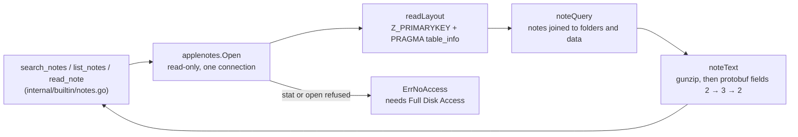

# applenotes

**Code:** `internal/applenotes/` (`doc.go`, `store.go`, `body.go`, `store_test.go`)
**Milestone:** none; added outside the milestones, read-only, for the Apple Notes tools
**Architecture:** [Approving a tool call](../../ARCHITECTURE.md#approving-a-tool-call), the built-in tools table and the paragraphs after it

## What it does

`applenotes` reads the Notes app's own database, `NoteStore.sqlite`, so the
built-in tools `search_notes`, `list_notes` and `read_note` (see
[builtin](builtin.md)) can answer from your Apple Notes. Each call opens the
database read-only, runs a query or two, and closes it. Nothing stays open, and
Meru keeps no copy or index of a note, so every answer shows the notes as they
are now.

It never writes. The database belongs to the Notes app and syncs with iCloud, and
a row written behind the app's back can break that sync. Writing through the app
would need `osascript`, which Meru doesn't run.

## The picture



## Walk through the code

### store.go: opening the database

```go
func Open(ctx context.Context, path string) (*Store, error) {
    if _, err := os.Stat(path); err != nil {
        switch {
        case errors.Is(err, fs.ErrNotExist):
            return nil, ErrNoDatabase
        case errors.Is(err, fs.ErrPermission):
            return nil, ErrNoAccess
        }
        ...
    }
    db, err := driver.Open(dataSourceName(path))
    ...
}
```

`os.Stat` asks the system about the file before SQLite does. Without Full Disk
Access, macOS refuses even that, so a missing grant shows up as
`fs.ErrPermission`, and `Open` returns `ErrNoAccess`. When the stat gets
through but SQLite still can't open the file, it reports `CANTOPEN` on the
first query; `noAccess` turns that into `ErrNoAccess` too. `errors.As` finds a
`*sqlite3.Error` anywhere in the error's chain, and its `Code` method says
which kind of failure it was ([more on errors](go-basics/errors.md)).

`driver.Open` comes from the same SQLite driver `internal/store` uses,
`ncruces/go-sqlite3`, which runs SQLite as WebAssembly, so no C compiler is
needed. `dataSourceName` asks for a read-only open (`mode=ro`), a connection
that refuses any write (`query_only`), and a 5-second wait while the Notes app
holds a lock. The driver's default file locks work with the standard SQLite
the Notes app uses, so the two can share the file. `db.SetMaxOpenConns(1)`
keeps it to one connection, since each tool call makes a query or two
([database/sql](go-basics/sql.md)).

### store.go: learning the layout

Apple publishes no schema, and it changes between macOS releases. So
`readLayout` asks the database:

- `Z_PRIMARYKEY` maps each Core Data entity name to a number. A row in
  `ZICCLOUDSYNCINGOBJECT` holds a note when its `Z_ENT` is the number for
  `ICNote`, and a folder for `ICFolder`. Other readers hard-code 12 and 15;
  `readLayout` looks them up.
- `pragma_table_info` lists a table's columns. `readLayout` takes the first
  name it knows from each list: `ZTITLE1` or `ZTITLE` for a note's title,
  `ZTITLE2` or `ZTITLE` for a folder's, and the date columns that exist.
  `ZMARKEDFORDELETION`, `ZISPASSWORDPROTECTED` and `ZFOLDERTYPE` are optional.

The `layout` struct keeps the answers, and `noteQuery` builds the one `SELECT`
every query shares from them. Only column names from this fixed list ever reach
the SQL; the user's words go in as `?` parameters.

### store.go: the queries

`all` returns every note, newest first, from one folder or all of them, and
decodes each note's text when asked. `Folders`, `Notes`, `Note` and `Search`
build on it:

- **Deleted notes stay out.** `noteFilter` drops rows marked for deletion and
  notes in Recently Deleted, the folder whose `ZFOLDERTYPE` is 1.
- **Locked notes keep their text.** `scanNotes` never decodes a locked note; it
  shows by title, marked locked.
- **Search is by words.** `Search` lowercases the query, splits it into words,
  and keeps notes that hold every word in their title or text. Notes whose
  title holds every word come first; within each group the newest come first,
  because `all` returned them in that order. `snippet` cuts about 240
  characters of text around the first word's first match, counting in runes so
  a cut never splits a character.
- **Dates count from 2001.** Core Data stores seconds since 1 January 2001;
  `appleEpoch.Add` turns them into a `time.Time`.

### body.go: a note's text

```go
func noteText(data []byte) (string, error) {
    zr, err := gzip.NewReader(bytes.NewReader(data))
    ...
    raw, err := io.ReadAll(io.LimitReader(zr, maxBodyBytes+1))
    ...
    doc, err := field(raw, fieldDocument)
    note, err := field(doc, fieldNote)
    text, err := field(note, fieldText)
    return string(text), nil
}
```

The Notes app stores each note's content in `ZICNOTEDATA.ZDATA`: gzip around a
protobuf, Google's compact binary format. `gzip.NewReader` reads the gzip
layer; `io.LimitReader` stops at 32 MiB plus one byte, so a damaged blob can't
fill memory, and the extra byte tells a body that is too long from one that
fits ([byte slices](go-basics/byte-slices.md)).

A protobuf message is a run of fields, each a number, a wire type and a value.
The text sits three messages deep: field 2 of the outer message holds the
document, field 3 of the document holds the note, and field 2 of the note holds
the text. `field` walks one message with `protowire`, the low-level reader from
`google.golang.org/protobuf`: `ConsumeTag` reads a field's number and type,
`ConsumeBytes` reads a nested message or a string, and `ConsumeFieldValue`
skips any other field. Each returns how many bytes it used, or a negative count
for malformed data. No generated code and no schema file are needed, and the
module was already in `go.mod` through OpenTelemetry.

A note whose data won't decode keeps an empty text: one damaged note mustn't
hide the rest.

## Tests

`store_test.go` builds a database in the shape of `NoteStore.sqlite` in a
temporary folder, in today's column layout and an older one, with note bodies
made by `protowire.Append…` and gzipped, so no real note is in the repository.
It checks the entity lookup, both layouts, deleted and Recently Deleted notes,
a locked note, search order, snippets, `ErrNoDatabase`, and `ErrNoAccess` from a
file whose mode is 0, which stands in for a missing Full Disk Access grant.

## Why it's built this way

- **Live reads, no index.** The npm server tried first kept its own index in
  `~/.notes/`, which refreshed only when the main database file's modified time
  moved. The Notes app writes new changes to the `-wal` file first, so a note
  created at 11:16 was still missing from search at 11:22. Reading the database
  on each call can't go stale.
- **Words, not meaning.** A live read has no vectors, so search matches words.
  Indexing notes into Meru's own search would have meant special cases in the
  indexer's pruning, re-embedding and citations, which all assume a file path.
- **The schema is found, not assumed.** Column names differ between macOS
  releases, and a wrong guess fails every query.
