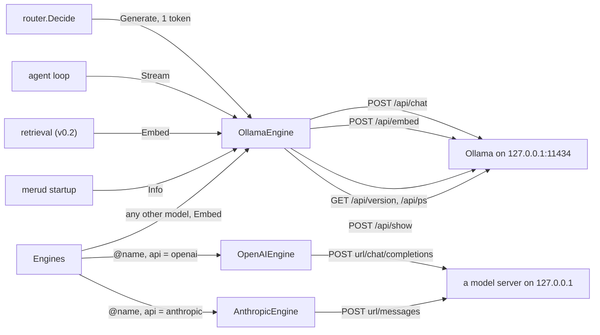

# engine

**Code:** `internal/engine/` (`engine.go`, `ollama.go`, `ollama_wire.go`,
`engines.go`, `endpoint.go`, `openai.go`, `openai_wire.go`, `anthropic.go`,
`anthropic_wire.go`, `observe_test.go`, `images_test.go`), and the loopback
check in `internal/loopback/loopback.go`
**Milestone:** v0.1; `Options.NoThink` in v0.4; `Message.Images` and
`Capabilities` with the desktop app's image attachments; `Details` with the
`about_meru` tool; `Engines` and the endpoint engines with #78
**Architecture:** [Engine layer](../../ARCHITECTURE.md#engine-layer), [Model tiers](../../ARCHITECTURE.md#model-tiers)

## What it does

The engine package is the only code in Meru that talks to a model. It defines the
`Engine` interface, four methods that every model call goes through, and
`OllamaEngine`, which implements them by sending HTTP (Hypertext Transfer Protocol)
requests to Ollama on this machine. The agent loop and the router call the
interface and never see Ollama's JSON (JavaScript Object Notation).

Two more engines answer for the models in `[[endpoints]]`: `OpenAIEngine`
speaks the OpenAI chat completions API, and `AnthropicEngine` the Anthropic
Messages API. `Engines` holds all of them and is the engine `merud` uses: a
call whose model starts with `@`, such as `@ollama-v1`, goes to that endpoint,
and everything else, every embedding included, goes to the local Ollama.

## The picture



The agent, the router and the indexer all hold `Engines`. Only the answer
model can name an endpoint; config refuses `@name` for `fast` and `embed`.

## Walk through the code

### engine.go

The interface and the types that pass through it: `Message`, `Options`,
`Completion`, `Delta`, `Usage`, and the log-probability types the router reads.
`Message.Images` holds the raw bytes of each image on a user message, and the
constant `Vision` names the capability a model needs to read them. `ToolUse`
names the one it needs to take a list of tools; Ollama refuses tools to a model
without it, such as `gemma3:12b`. A
Go *interface* is a list of method signatures; any type with those methods counts
as that interface. See [go-basics/interfaces.md](go-basics/interfaces.md).

`Input` is one thing for `Embed` to turn into a vector: `Text`, `Image` bytes, or
both, with `Title` for a document's heading and `Query` for a search query.
`Texts("a", "b")` wraps plain strings for a caller that has nothing more, such
as the warm-up. `Prompts` holds an embedding model's task prefixes, with
`{query}`, `{title}` and `{text}` where the input goes; its zero value adds
nothing.

### The loopback check

`NewOllama` calls `loopback.CheckURL`, which lives in its own package,
`internal/loopback/loopback.go`, so config, obs and the clients can share it. It
decides whether a URL points at this machine:

```go
if strings.EqualFold(host, "localhost") {
    addrs, err := net.DefaultResolver.LookupNetIP(ctx, "ip", host)
    // ... every address must be loopback
}
addr, err := netip.ParseAddr(host)
if !addr.Unmap().IsLoopback() { /* refuse */ }
```

It accepts an IP address in 127.0.0.0/8, `::1`, or the name `localhost` when
every address it resolves to is loopback. It refuses every other host name
without a lookup, because only `localhost` is reserved for this machine; another
name could point here today and elsewhere tomorrow. `Unmap` turns
`::ffff:127.0.0.1`, an IPv4 address written as IPv6, back into plain IPv4 so the
test sees it. `loopback.IsURL` wraps it for callers that want a yes or no.

### ollama.go

`NewOllama` checks the URL, turns `keep_alive` into the JSON Ollama accepts, and
copies the HTTP client so it can refuse redirects. A redirect could bounce a
prompt to another host. Its last argument is a `*slog.Logger` for debug lines;
nil means no lines.

`ContextLength` is an exported field, not an argument, so the many tests that
build an engine didn't change. `merud` sets it once, from
`[ollama] context_length`, before the first call. When it is above 0, every
chat call sends it as `num_ctx` in `options`, so each model loads with room for
Meru's prompts of about 25,000 tokens whatever Ollama's own default is. Every
call to one model sends the same value, since Ollama reloads a model when
`num_ctx` changes.

**Windows per model (window.go).** `SetWindow(model, n)` gives one model a
window of its own, and `Window(model)` returns what a chat call sends: that
window, or `ContextLength`. The map sits beside `shown`, under the same `mu`.
`merud` sets the answer model's window from `FitWindow(details, budget,
fallback)`, which takes the model's most tokens, cuts them to what fits in
`budget` bytes of cache, rounds down to a multiple of 1,024, and never returns
less than `fallback`. A model with no known cache size gets `fallback`.

`details` works the cache size out in `kvBytesPerToken`. Each layer caches a
key and a value per head, `key_length` and `value_length` numbers wide, at 2
bytes each. `head_count_kv` comes as one number for every layer, which the code
multiplies by `block_count`, or as a list with one per layer. A hybrid model
such as qwen3.6 lists 0 for the three layers in four that keep no cache. The
code tries `json.Unmarshal` into an `int64` first and a `[]int64` second; the
one that succeeds says which shape came. A model without `key_length` uses
`embedding_length / head_count`, the usual width of a head.

```go
if n, err := strconv.Atoi(s); err == nil {
    return json.RawMessage(strconv.Itoa(n)), nil // "-1" goes out as the number -1
}
```

Ollama reads a JSON number as seconds and a JSON string as a Go duration. The
string `"-1"` fails there with "missing unit", so whole numbers go out as numbers
and `"5m"` goes out as a string.

`Generate` posts to `/api/chat` with `stream: false` and copies the reply into a
`Completion`: the text, any tool calls, the stop reason, the counters and the log
probabilities. When the caller sets `Options.LogProbs` or `Options.NoThink`, the
request also carries `think: false`. MiniCPM5 is a "thinking" model: by default
its first tokens are hidden reasoning, so a one-token call would return the
probabilities of the word "We" instead of a route letter. We checked this
against Ollama 0.34. The agent's skill pick and the session summarizer set `NoThink`: one wants a
skill name within 20 tokens, the other two sentences, and neither gains from
reasoning first.

`Unload(ctx, model)` drops a model from Ollama's memory. It posts to
`/api/generate` with the model, no prompt, `stream: false` and `keep_alive: 0`,
which is how Ollama's docs unload a model; config's `keep_alive` doesn't apply
to this one call. Ollama answers at once and frees the memory a moment later,
so `merud` then asks `/api/ps` until the model is gone (`cmd/merud/models.go`).
`Pulled` reads `/api/tags` and now returns a `PulledModel` for each model, its
name and its size in bytes. Both sit outside the `Engine` interface, which keeps
its four methods.

`Stream` posts with `stream: true`. Ollama answers with NDJSON (newline-delimited
JSON): one JSON object per line. `Stream` returns an iterator that reads a line,
turns it into a `Delta` and hands it to the caller's loop. The last line has
`done: true` and carries the counters. See
[go-basics/iterators.md](go-basics/iterators.md).

```go
for sc.Scan() {
    var r chatResponse
    if err := json.Unmarshal(line, &r); err != nil { ... }
    if r.Done { yield(d, nil); return }
    if !yield(d, nil) { return } // the caller left the loop
}
```

A line with an `error` field ends the stream with an error. Ollama sends one
when its parser for the model's own format rejects what the model wrote,
most often a tool call, and by then it has already answered 200 OK. Ollama
0.34 sent `{"error":"XML syntax error on line 8: element <function> closed
by </parameter>"}` for a malformed call from a qwen model. `Stream` wraps
every such line in the sentinel error `ErrModelOutput`:

```go
var ErrModelOutput = errors.New("ollama couldn't read the model's output")
...
fail(fmt.Errorf("ollama stream: %w: %s", ErrModelOutput, r.Error))
```

A *sentinel* is one error value made once with `errors.New` for callers to
compare against. `%w` wraps it, so `errors.Is(err, engine.ErrModelOutput)`
finds it under any context the callers add, and the agent retries the round
(see [agent](agent.md)). `Stream` reads nothing more into Ollama's wording:
any error line counts. A failure before the stream starts, such as a non-2xx
status or Ollama down, is an `*APIError` or a transport error instead, and
asking the model again won't fix it.

One exception: Ollama sometimes sends the parser error as a 500 from
`/api/chat` before any text. `APIError` has an `Unwrap` method, which
`errors.Is` calls to look inside an error; it returns `ErrModelOutput` for a
500 from `/api/chat` whose message holds the words Ollama's parsers use, such
as "syntax error" or "closed by", and nil for every other `*APIError`. So that
one case retries like a bad line mid-stream, and a model that fails to load
still fails the turn.

`Embed` posts all texts to `/api/embed` in one request and checks that one vector
came back per text. `Info` reads `/api/version` and `/api/ps`.

`do` sends every request. It builds it with `http.NewRequestWithContext`, so
cancelling the context aborts the connection, even partway through a stream. On a
status outside 200–299 it reads Ollama's `{"error": "..."}` body and returns an
`*APIError`. Callers can find that error with `errors.As`, for example to spot a
404 for a model that isn't pulled. See [go-basics/http-clients.md](go-basics/http-clients.md).

`Details(ctx, model)` sends `POST /api/show` with `{"model": ...}` and
returns a `ModelDetails`: the `capabilities` list, such as
`["completion", "vision", "tools", "thinking"]`, the parameter size (`36.0B`),
the quantization (`Q4_K_M`), the context length, and `KVBytesPerToken`, the
cache a token takes (see "Windows per model"). Ollama files the context
length under the model's architecture, as `qwen35moe.context_length`, so
`showResponse.details` finds the key by its ending. The reply also holds the
license and the list of tensors, over 100 KB for a large model; the decoder
skips every field `showResponse` doesn't name. `Remote` is true when the reply
names a `remote_host` or `remote_model`, as it does for one of Ollama's cloud
models.

**No cloud models.** Ollama can run a model on ollama.com and answer for it on
loopback, so the loopback check alone can't keep a prompt on the machine.
`Generate`, `Stream` and `Embed` call `localOnly` before they build a request.
It refuses a model whose name `config.CloudModel` marks, such as
`gpt-oss:120b-cloud`, and one whose `Details` say `Remote`, which catches a cloud
model copied to a plain name. Both fail with `ErrCloudModel`, and no request
goes out. `Details` caches its reply, so the check costs one `/api/show` per
model per run; a model Ollama can't describe passes, and its request then fails
on its own if the model isn't there (#211).

`Capabilities(ctx, model)` returns `Details(ctx, model).Capabilities`.
`Pulled(ctx)` sends `GET /api/tags` and returns the names of the models Ollama
has on disk, such as `gemma3:12b` and `nomic-embed-text:latest`. None of the
three is one of the four `Engine` methods: only a question with images asks
`Capabilities`, only `about_meru` and the models in Settings ask `Details`, only
the models in Settings ask `Pulled`, and `merud` hands each caller the one method
it needs. The answer for each model goes in a map, `shown`, so a
second question about the same model doesn't wait on Ollama; a failed call
stores nothing. Several turns can ask at once, so a `sync.Mutex`, `mu`, sits
next to the map and every read and write takes it. `clone` hands the caller a
copy made with `slices.Clone`, so no caller can change the cached list.

### What each call logs and traces

Each HTTP call gets a client span from `startSpan`, named like `POST /api/chat`,
with `http.request.method`, `url.full` and the body's size. It nests under the
caller's span: the router's or the agent's `gen_ai.chat`. `do` adds
`http.response.status_code` and writes one debug line:

```text
msg="ollama http" method=POST path=/api/chat status=200 headers_ms=29 model=… stream=true num_predict=0 logprobs=false images=0
```

`headers_ms` is the time until Ollama's response headers arrived. A streaming
call then logs `ollama first token`, with the time since the request started
and `thinking_chunks`: how many chunks carried only hidden reasoning before the
first word. A thinking model can spend seconds there, and this count is how the
log shows it. Every chat call ends with `ollama done`, which holds Ollama's
counters: `prompt_tokens`, `output_tokens`, `load_ms`, `prompt_eval_ms`,
`eval_ms` and `tokens_per_s`. The streaming span also gets
`meru.ollama.thinking_chunks`.

A failed call goes through `fail`, which marks the span through
`obs.EndSpanErr` and logs `ollama error` with the path, the time and the error,
Ollama's own message included. `fail` returns the error too, so the caller
still decides what the user sees; the debug line adds only the timing.

The stream's span stays open while the caller reads the stream, and the
iterator ends it when the stream ends. No span or log line holds a message's
text, and none holds an image: the `images` field counts them.

### engines.go

`Engines` keeps the local `*OllamaEngine` and a map of `Endpoint` values by
name. Each method looks at the model first:

```go
ep, ok, err := e.endpoint(opts.Model) // "@lab" → the "lab" entry
if !ok {
    return e.local.Generate(ctx, msgs, tools, opts)
}
opts.Model = ep.Model // the name the server knows
return ep.Engine.Generate(ctx, msgs, tools, opts)
```

`Engines` also has the methods `merud` asks of Ollama outside the interface:
`Details`, `Capabilities`, `Pulled`, `Unload`, `SetWindow` and `Window`. For an
endpoint they answer from its `[[endpoints]]` entry: `Details` gives the
entry's `context_length` and capabilities (`vision`, `tools`), `Window` the
`context_length`, `Unload` and `SetWindow` do nothing, and `Pulled` adds each
working endpoint as `@name`. So the vision check, the tools check, the prompt's
budget and a model switch treat an endpoint the way they treat a local model.
An `Endpoint` with `Err` set, such as one whose key `secrets.toml` lacks, fails
each call with that error, and the rest of Meru keeps working.

### endpoint.go

What the two endpoint engines share:

- `reachClient` builds each endpoint's HTTP client from its reach. `local`
  needs a loopback URL, as `NewOllama` does. `remote` needs https. `near-edge`
  gets a `net.Dialer` whose `Control` hook, `nearEdgeOnly`, runs after Go has
  resolved the host name and before it connects, and refuses any address
  `loopback.NearEdge` doesn't accept: a public IP, or a name that resolves to
  one. Off the machine the client sets `Proxy: nil`, since a proxy from the
  environment would make the connection, and so the check, somewhere else.
  Every client refuses redirects. `NewOllamaEndpoint` uses the same client
  for another Ollama. The agent asks the user before a turn reaches one of
  these (see [agent](agent.md), consent.go).
- `post` sends one request with its span (`POST /chat/completions`, with a
  `meru.endpoint` attribute) and turns a non-2xx reply into an
  `*EndpointError`, whose message says what to do for a 401 (check the key in
  `secrets.toml`) or a 429 (try again in a minute). The key travels only in a
  request header, and nothing here logs headers.
- `readSSE` reads a server-sent event stream; see
  [server-sent events](go-basics/server-sent-events.md).
- `toolCallIDs` ties each tool result to its call. Both APIs match them by ID,
  while Meru's messages carry the tool's name in call order. A call with no ID
  gets `call_<message>_<n>`.

### openai.go and anthropic.go

Each `Stream` ranges over `readSSE` and yields text as it arrives. A tool
call arrives in pieces: the OpenAI API numbers them with `index`, sends the
ID and name in the first piece, and splits the arguments anywhere, even
inside a string. The Anthropic API sends a `content_block_start` with the ID
and name, then `input_json_delta` fragments. Both engines join the pieces and
hand the whole calls out on the last `Delta`, as `OllamaEngine` does, so the
agent loop sees one shape.

Neither engine reads the model's reasoning: the OpenAI-style servers send it in
fields such as `reasoning_content`, which the wire types leave out, and the
Anthropic API in `thinking` blocks, which the engine skips. Both map their stop
reasons to Meru's: `length` and `max_tokens` become `length`, which the agent
reads as an answer cut off. The Anthropic API requires `max_tokens`, so a call
without a cap sends `defaultMaxTokens`, 8,192.

`toOAMessages` and `toAnMessages` in the `_wire.go` files turn Meru's messages
into each API's. A tool result goes back as a `tool` message tied by ID (OpenAI)
or a `tool_result` block in a user message (Anthropic). A picture goes as a
`data:` URL part (OpenAI) or a base64 `image` block (Anthropic). An OpenAI `tool`
message can't hold a picture, so the pictures `view_image` returned follow in
one user message after the round's results.

### ollama_wire.go

Ollama's own JSON shapes (`chatRequest`, `chatResponse`, `wireLogProb`, …) and the
functions that convert them to and from Meru's types. Ollama nests a tool call's
name and arguments inside a `function` object, and a tool spec inside
`{"type": "function", "function": ...}`; this file is the only place that knows.

Ollama reports durations in nanoseconds. `time.Duration` also counts
nanoseconds, so `time.Duration(r.LoadDuration)` converts one to the other.

`embedItem` is one entry of an embed request's `input`, and it has its own
`MarshalJSON`, so it can come out in two shapes:

```text
"sow tomatoes in April"                       text alone: a plain string, as always
{"image": "iVBORw0KGgo..."}                    an image: an object, bytes in base64
{"text": "a cat", "image": "iVBORw0KGgo..."}   both together
```

Two other shapes look right, and Ollama answers both with a valid vector that
has nothing to do with the picture: an `images` list beside `input`, and a
`"data:image/png;base64,..."` string, which it embeds as text. That is why the
integration test compares two different images and checks their vectors
differ. `Prompts.apply` builds the text: the query prefix for a query, the
document prefix with `none` for a missing title, or, with no prefix, the title,
a blank line and the text, the form the indexer always sent. `embedOptions`
carries `num_ctx`, which `Embed` sends on every call from `EmbedContext`.

`chatMessage.Images` is a `[][]byte` with the JSON key `images`. Ollama wants
each image as a base64 string, and `encoding/json` writes any `[]byte` as
base64, so the conversion needs no code. `showRequest` and `showResponse` are
the two shapes of `/api/show`; Meru reads only `capabilities` from the reply.

## Go ideas used here

- **Interfaces** — a type satisfies an interface by having its methods. More in
  [go-basics/interfaces.md](go-basics/interfaces.md).
- **HTTP clients and context** — requests tied to a `context.Context`, bodies you
  must close. More in [go-basics/http-clients.md](go-basics/http-clients.md).
- **Iterators (`iter.Seq2`)** — a function you can range over. More in
  [go-basics/iterators.md](go-basics/iterators.md).
- **Struct tags** — the `` `json:"model"` `` text after a field tells
  `encoding/json` which key to use; `omitempty` drops empty fields.
- **`json.RawMessage`** — bytes of JSON passed through untouched. Tool arguments
  and `keep_alive` use it.
- **`[]byte` in JSON** — `encoding/json` writes a byte slice as a base64
  string and reads one back the same way. `Message.Images` relies on it.
- **`MarshalJSON`** — a type with this method decides its own JSON, so
  `embedItem` is a string or an object. More in
  [go-basics/json-marshaler.md](go-basics/json-marshaler.md).
- **`sync.Mutex`** — `mu.Lock()` lets one goroutine at a time into the
  capabilities map. More in [go-basics/goroutines.md](go-basics/goroutines.md).
- **Server-sent events**: the OpenAI and Anthropic APIs stream `data:` lines,
  read with `bufio.Scanner`. More in
  [go-basics/server-sent-events.md](go-basics/server-sent-events.md).
- **`any`**: `oaMessage.Content` holds a string or a list of parts, and
  `encoding/json` writes whichever it holds.

## Try it

```sh
go test -race ./internal/engine/
```

The unit tests start a fake Ollama with `httptest` and need no model.
`observe_test.go` checks the span, the status attribute and each debug line,
and that no message text reaches either. `TestStreamErrors` checks that an
error line, Ollama's XML error among them, satisfies
`errors.Is(err, ErrModelOutput)` and that a bad JSON line or a stream with no
done line doesn't. `TestStreamHTTPErrorIsNotModelOutput` checks that an HTTP
500 stays an `*APIError`, and `TestStreamParserErrorBeforeTextIsModelOutput`
that a 500 holding Ollama's XML error wraps `ErrModelOutput`. `images_test.go` checks that a user message's images
reach `/api/chat` as base64 strings and the system message carries none, and
`TestCapabilities` feeds `/api/show` replies for a model with vision, one
without, an older reply with no `capabilities` key and a 404; a good answer is
asked for once, a failure twice. `TestDetails` reads size, quantization and
context length from a reply shaped like Ollama 0.34's for `qwen3.6:35b`, checks
that changing the returned list leaves the cache alone, and that `Details` and
`Capabilities` share one request. To run against the real Ollama:

```sh
go test -tags integration -v -run Integration ./internal/engine/
```

You should see the one-token call pick `B` with a log probability near 0.

The endpoint engines have their own tests. `openai_test.go` and
`anthropic_test.go` run each engine against `fakeEndpoint`, an `httptest`
server: text, tool calls split mid-string, pictures, a cut-off answer, an
error event, a stream cut short and a cancelled turn. `endpoint_test.go`
checks the event reader, the ID pairing, the loopback check, a refused
redirect, and that an error never holds the key. `engines_test.go` checks
that each call goes to its engine. `openai_integration_test.go` runs
`OpenAIEngine` against the real Ollama's own `/v1`, with no key:

```sh
go test -tags integration -v -run IntegrationOpenAI ./internal/engine/
```

## Why it's built this way

- **Native `/api/chat`, not Ollama's OpenAI-compatible endpoint.** The native API
  returns the counters (`load_duration`, `eval_count`, …) that
  [Observability](../../ARCHITECTURE.md#observability) needs, takes
  `keep_alive`, and gives the router token probabilities. The OpenAI-style
  engine exists for other model servers, and Ollama's `/v1` is its test.
- **Two small engines, no SDK.** The standard library reads both APIs and
  their event streams. A provider's SDK would put a cloud client in the
  module graph, which the policy tests forbid, and the user types every URL,
  so the code names no provider's address.
- **`/api/chat` for the router too.** The design note sketches `/api/generate`, but
  Ollama 0.34 returns log probabilities from `/api/chat`, so one endpoint covers
  every answer. `/api/generate` with a raw prompt would also skip the model's chat
  template, and Meru would then have to know each model's template.
- **Thinking off only when a caller asks.** A call that asks for log
  probabilities wants the answer's tokens, so `LogProbs` turns thinking off by
  itself. The skill pick and the session summarizer need thinking off without log
  probabilities, so `Options` gained `NoThink`. It is a field on `Options`, not a new
  method: the `Engine` interface keeps its four methods. Every other call leaves
  the model's default alone.
- **Images as a field, capabilities as one method outside the interface.** A
  question with images still goes through `Stream`, so the images ride on the
  `Message`. Asking what a model can do is Ollama's business, and only the
  agent's image turns need it, so it stays off the interface, which keeps its
  four methods.
- **No overall client timeout.** A long answer can stream for minutes. The caller's
  context decides when to give up.
