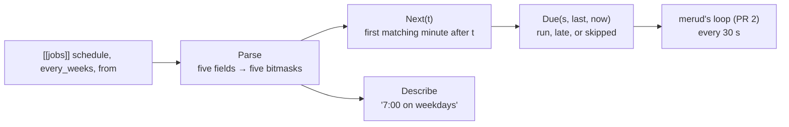

# jobs

**Code:** `internal/jobs/` (`doc.go`, `schedule.go`, `due.go`, `schedule_test.go`, `due_test.go`)
**Milestone:** v0.5, the first step of scheduled jobs ([#167](https://github.com/aarora79/meru/issues/167))
**Architecture:** [Scheduler](../../ARCHITECTURE.md#scheduler)

## What it does

`jobs` holds the time rules for scheduled jobs. It reads a schedule such as
`0 7 * * 1-5` (7:00 on weekdays), finds the next time it matches, says it in
words for the clients, and decides whether a job should run now given its last
run. It runs nothing and stores nothing: `merud` owns the loop that asks it, the
run and the record. With no model, store or file in sight, the tests drive it
with whatever clock they like.

## The picture



## Walk through the code

### schedule.go: a schedule as five bitmasks

A cron expression has five fields: minute, hour, day of month, month and day of
week. `Parse` turns each into a set of the values it allows, kept as the bits of
a `uint64`: bit 7 of `hour` is set when 7:00 matches. "1-5" in the day-of-week
field sets bits 1 to 5:

```text
day of week  6 5 4 3 2 1 0
"1-5"        0 1 1 1 1 1 0    Monday to Friday
```

A `uint64` has room for the 60 minutes, so one type serves every field, and
testing a value is a shift and an AND:

```go
func has(mask uint64, v int) bool { return mask&(1<<v) != 0 }
```

[go-basics/bitmasks.md](go-basics/bitmasks.md) explains `<<`, `|`, `&` and `&^`.

`parseField` reads one field: a comma list of items, each `*`, a number, a name
(`mon`, `jan`), a range (`1-5`), or one of those with a step (`*/15`, `0-30/10`).
Errors name the field: "hour: 25 is past 23". Sunday may be written 7, and
`Parse` folds bit 7 into bit 0 with `s.dow&^(1<<7) | 1`: `&^` clears a bit.

Cron has an odd day rule, and `domStar` and `dowStar` keep it: when both day
fields are restricted, a day matches if either one does; when one is `*`, only
the other decides. `0 9 15 * 1` runs on the 15th and on every Monday.

### Next: skipping what can't match

`Next(t)` returns the first matching minute after `t`. Trying each minute would
take half a million steps for a yearly job, so it skips whole units that can't
match: a month that isn't in the set jumps to the first of the next month, a day
that doesn't match jumps to midnight, an hour to the next hour. Only inside a
matching hour does it step by minutes.

It builds each candidate with `time.Date` from the wall clock, and `time.Date`
normalizes overflow: month 13 is January of the next year, minute 60 is the next
hour. That makes daylight saving time come out the way people expect:

- On the night clocks jump from 2:00 to 3:00, `time.Date(…, 2, 30, …)` gives a
  time whose hour is 3, so a 2:30 job doesn't match that day.
- On the night 1:00 to 2:00 happens twice, `time.Date` gives the first 1:30, so
  the job runs once. A candidate can then come out before `t`; the `!c.After(t)`
  case steps past it.

Each step must move forward, so a jump that lands on the same instant moves one
minute instead. `searchYears` (5) bounds the search, and `Parse` refuses a
schedule that never matches, such as 31 February.

`every_weeks` and `from` cover what cron can't: every other Tuesday. `from` is
the first day the job may run, and the weeks count from the Monday of its week,
so the rhythm stays on whole weeks. `daysBetween` compares dates in UTC, so a
23- or 25-hour day around a clock change doesn't shift the count.

### Describe

`Describe` says the common shapes in words: "7:00 on weekdays", "every 15
minutes every day", "9:00 on Tuesdays, every other week from 27 October 2026".
A shape it has no words for comes back as "at" and the expression, so the
clients always show something true.

### due.go: run now, late, or skip

`Due(s, last, now)` decides for one job. When the next slot after `last` hasn't
come, nothing happens. When slots have passed, the job runs once, for the
latest: an hourly job that missed six hours overnight runs one time, since each
run does the same work. `Late` says how long ago that slot was, for the prompt's
"this ran late" line. When every missed slot is more than `CatchUp` (12 hours)
old, the job doesn't run and `Skipped` names the first slot missed, so `merud`
can log it and move on.

## Go ideas used here

- Bit operations on a `uint64` as a small set: [bitmasks](go-basics/bitmasks.md).
- `time.Date` normalizing out-of-range values, and `time.Location` for the
  computer's time zone.
- `for range 4`, a loop that runs four times (Go 1.22).
- The blank import `_ "time/tzdata"` in the tests, which embeds the time zone
  database so the daylight saving tests read the same rules on every machine.

## Try it

```sh
go test ./internal/jobs -run TestNext -v
```

## Why it's built this way

- **No cron library.** One, `robfig/cron`, runs its own goroutines on Go timers;
  Meru needs only the parser and the next-time search, about 150 lines.
- **A loop that checks the clock, not a timer per job** (in `merud`, PR 2): a
  check every 30 seconds finds a run that fell due while the Mac slept within 30
  seconds of waking, whatever Go's timers do across sleep.
- **One run for many missed slots, and a 12-hour limit,** so a Mac that slept
  overnight gets its morning brief at breakfast, and one that was off all day
  doesn't get it at 9 p.m.
