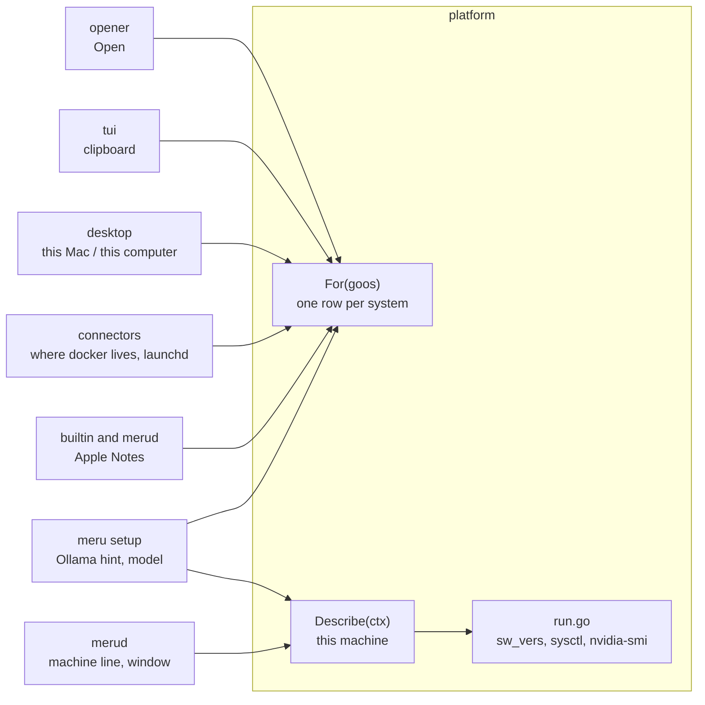

# platform

**Code:** `internal/platform/` (`doc.go`, `platform.go`, `machine.go`, `run.go`)
**Milestone:** v0.6 (Meru on Ubuntu, [#84](https://github.com/aarora79/meru/issues/84))
**Architecture:** [One table of differences](../../ARCHITECTURE.md#one-table-of-differences)

## What it does

`platform` holds what Meru does differently on macOS, Linux and Windows. Before
it, eight files each asked `runtime.GOOS`, Go's name for the system (`"darwin"`,
`"linux"` or `"windows"`), and each kept its own list of Mac programs and folders.
Now they ask this package. It also reads the machine `merud` runs on, its
graphics processor (GPU) included, so `merud` sizes the answer model's context
window, and `meru setup` suggests an answer model, from the memory the model
loads into.

## The picture



## Walk through the code

### platform.go

A **struct** is a type with named fields. `Platform` is one system's row:

```go
type Platform struct {
    GOOS, Name, Here string
    Open             []string   // the opener, such as {"xdg-open"}
    Clipboard        [][]string // copy programs, in the order to try
    ProgramDirs      []string   // where docker may be, "~/" for home
    OllamaHint       string
    AppleNotes       bool
    Service          string     // "launchd", "systemd" or ""
    SharedGPUMemory  bool
}
```

(The real file gives each field its own line and comment.) `[]string` is a
**slice**, Go's growable list; `[][]string` is a list of lists, one per program
with its arguments.

`rows` builds the table, and `For` returns the row whose `GOOS` matches:

```go
func For(goos string) Platform {
    for _, p := range rows() {
        if p.GOOS == goos {
            return p
        }
    }
    p := For("linux")
    p.GOOS, p.Name = goos, goos
    return p
}
```

`for _, p := range rows()` loops over the slice; `_` throws away the index. A
system with no row, such as FreeBSD, gets the Linux programs under its own name.
`rows` is a function, not a package-level variable, so each call builds fresh
slices and no caller can change the table for everyone else. `Current()` is
`For(runtime.GOOS)`.

### machine.go

`Describe` fills a `Machine`: the system and version, processor, main memory, and
the GPU with its memory. A `switch` on `runtime.GOOS` picks where to read:

| System | Reads |
| --- | --- |
| macOS | `sw_vers -productVersion`, and `sysctl` for the chip and memory |
| Linux | `/etc/os-release`, `/proc/cpuinfo`, `/proc/meminfo`, and `nvidia-smi` for the GPU |
| Windows | the name only, for now |

Each source has its own small parser that takes text and returns a value, such as
`nvidiaSMI`:

```go
// nvidia-smi --query-gpu=name,memory.total --format=csv,noheader,nounits
// prints one "NVIDIA L40S, 46068" line per card.
func nvidiaSMI(text string) (string, int)
```

The function returns two values, the name and the gigabytes; Go functions can
return several. The parsers take text instead of reading files, so the tests feed
them a Mac's or an Ubuntu box's output on any machine.

`ModelMemoryGB` is a **method**, a function attached to a type, called as
`m.ModelMemoryGB()`. It returns the GPU's own memory when there is a GPU with
memory of its own, and main memory otherwise. On a Mac the GPU uses main memory,
so `Describe` leaves `GPUMemoryGB` at 0, and main memory is the right answer.

### run.go

`run` starts a program with `exec.CommandContext`, with no shell and a
three-second timeout, and returns its output, or `""` when anything goes wrong.
`Describe` never fails: a fact it can't read stays empty, because every caller
works without it. `internal/policy` checks that `run.go` is the only file here
that imports `os/exec`, and that the package imports only the standard library.

## Go ideas used here

- **os/exec** — starts another program without a shell. More in
  [go-basics/os-exec.md](go-basics/os-exec.md).
- **context** — `WithTimeout` bounds how long a program may run. More in
  [go-basics/context.md](go-basics/context.md).
- **defer** — `defer cancel()` frees the timer on every return. More in
  [go-basics/defer.md](go-basics/defer.md).
- **build tags** — the option this package didn't take; see below. More in
  [go-basics/build-tags.md](go-basics/build-tags.md).

## Try it

```sh
go test ./internal/platform/ ./internal/policy/
```

On a Linux machine with an NVIDIA card, `merud`'s log shows the GPU in its
`machine` line at startup, such as `NVIDIA L40S with 45 GB GPU memory`.

## Why it's built this way

Go's usual answer to "this differs by system" is build tags: a
`platform_darwin.go` and a `platform_linux.go` that each define the same
functions, with the compiler keeping one. That suits code that calls a system's
own API, as `internal/secrets` does for file modes. Here every difference is data:
a program name, a folder, a yes or no. With build tags a test on Linux could check
only the Linux answers, and the Mac's would go untested until someone ran the
tests on a Mac. One table lets every test run check every row.

Features that exist on one system only, such as Apple Notes, Meru.app and the Mac
installer, stay in their own packages. The code checks a row's field, such as
`AppleNotes`, instead of comparing system names.
