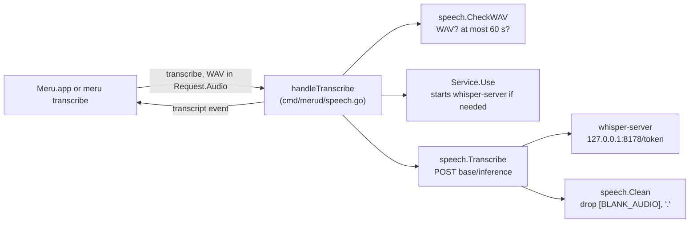

# speech

**Code:** `internal/speech/` (`doc.go`, `speech.go`, `speech_test.go`), and
`cmd/merud/speech.go`, which answers the `transcribe` op with it
**Milestone:** none; added outside the milestones, for speech to text
**Architecture:** [Speech to text](../../ARCHITECTURE.md#speech-to-text)

## What it does

`speech` turns a recording into text. `merud`'s `transcribe` op hands it the
bytes of a WAV file and the base URL of the whisper connector's server, which
the connector's `Service` gives (see [connectors](connectors.md)). `speech`
checks the file, posts it to the server, and cleans what comes back.

It starts no program and knows no model names: the connector owns both. It
never writes the audio to disk and never logs the words.

## The picture



## Walk through the code

### speech.go: CheckWAV

A WAV file is a RIFF file: the four letters `RIFF`, a size, `WAVE`, then
chunks. Each chunk is a four-letter ID, a 32-bit size and that many bytes.
`CheckWAV` walks them:

```go
for at := 12; at+8 <= len(wav); {
    id := string(wav[at : at+4])
    size := binary.LittleEndian.Uint32(wav[at+4 : at+8])
    ...
    next := body + int(size) + int(size%2)
```

`binary.LittleEndian.Uint32` reads four bytes with the lowest first, the
order RIFF writes them. A chunk of odd size has a padding byte after it,
which `size%2` adds. The `fmt ` chunk gives the format, where 1 is plain PCM
and 3 is float, and the bytes per second; the `data` chunk's size is the
sound. Dividing the two gives the length in seconds. A macOS recording can
carry a `LIST` chunk before `fmt `, so the walk can't assume an order.

It fails with `ErrNotWAV` for anything else, such as an `.m4a` file, which
`whisper-server` would refuse without ffmpeg, and with `ErrTooLong` past
`MaxSeconds`, 60, plus half a second for a recorder that stops a few samples
late. Both are sentinel errors, values the caller compares with `errors.Is`
([more on errors](go-basics/errors.md)).

### speech.go: Transcribe

`whisper-server` takes a form upload, the kind a web page's file field
sends. `mime/multipart` builds it: `CreateFormFile` adds the file, and
`WriteField` adds `temperature=0.0`, so the same recording always gives the
same words, and `response_format=json`. The request goes to
`<base>/inference`, where `base` holds the token path the connector made for
this start. The answer is `{"text": "..."}`, or `{"error": "..."}`, which
`Transcribe` turns into an error. It reads at most 1 MiB of answer.

`merud` passes an `http.Client` whose `CheckRedirect` refuses every
redirect: the server is on loopback and has none to give, and a redirect
could carry the audio elsewhere.

### speech.go: Clean

Whisper doesn't answer silence with nothing. `base.en` writes
`[BLANK_AUDIO]`, and `large-v3-turbo` writes `.`. `Clean` drops anything in
square brackets with a regular expression, joins the lines, and returns ""
when no letter or digit is left. `strings.ContainsFunc` with
`unicode.IsLetter` counts letters in any alphabet, so a recording in Hindi or
Japanese passes.

### cmd/merud/speech.go: handleTranscribe

The handler runs the three steps, with the connector between them:

```go
seconds, err := speech.CheckWAV(req.Audio.WAV)
...
base, done, err := s.conns.speech.Use(ctx)
...
defer done()
text, err := speech.Transcribe(ctx, speechClient, base, req.Audio.WAV)
```

`Use` starts `whisper-server` when it isn't running, and `done` tells the
connector the request is over, so its ten-minute idle timer can start. A
deferred function records `meru.speech.duration` with the model and the
outcome, and logs one line with the model, the seconds of audio, the
milliseconds and the outcome. The words never go in the log
([defer](go-basics/defer.md)).

The outcome is one of five: `ok`, `empty` when nothing was heard,
`too_long`, `cancelled` when the client hung up, and `error`.

### The socket

`rpc.Request` gains `Audio *Audio`, a pointer to a struct holding the bytes,
as `Images` is: a `[]byte` field would stop a `Request` being comparable with
`==`, which tests rely on. `encoding/json` writes a `[]byte` as base64, so a
minute of 16 kHz mono 16-bit audio, 1.9 MB, travels as 2.6 MB. A request line
may run to `rpc.MaxRequestLine`, 4 MiB; events and replies keep the 1 MiB
`maxLine` (see [rpc](rpc.md)).

### meru transcribe

`cmd/meru/transcribe.go` reads a file, refuses one over 3 MiB before
reading it, sends it as the op's audio, and prints the words or "(Meru heard
no words.)". It lets a user try speech to text without Meru.app, and a
script use it.

## Tests

- `speech_test.go` builds WAV files byte by byte: 16 kHz mono, 48 kHz stereo
  float, a `LIST` chunk of odd size first, 60 and 61 seconds, ADPCM, and a
  file that isn't RIFF. It checks `Transcribe`'s form against an
  `httptest` server, its errors, and `Clean` on each marker.
- `cmd/merud/speech_test.go` checks the handler's refusals, which need no
  server: no recording, not WAV, too long, the connector off.
- `cmd/meru/transcribe_test.go` runs the command against an in-process
  server.
- `internal/rpc/server_test.go`'s `TestRequestLineLimit` sends a minute of
  audio and a request over the limit.
- `connectors.TestIntegrationWhisper`, with the `integration` tag, posts a
  real clip to the real server.

## Why it's built this way

- **WAV only.** `whisper-server` reads WAV without ffmpeg, and Meru.app
  builds WAV itself. Reading the header in Go costs 60 lines and gives a
  clear refusal before the server starts.
- **No Engine method.** The `Engine` interface is Ollama's, with four
  methods. Speech to text runs in another program, so it gets a package of
  its own with plain functions and no interface, since there is one backend.
- **Clean in Meru, not in the client.** Both clients would need the same
  rules for Whisper's markers; doing it once in `merud` keeps them out of
  every client.
