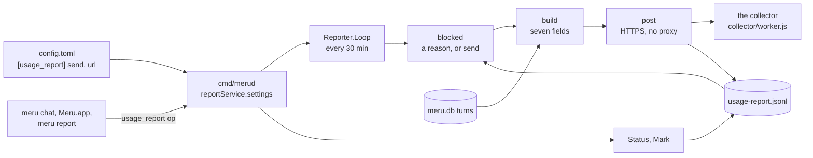

# usagereport

**Code:** `internal/usagereport/` (`doc.go`, `report.go`, `log.go`, `send.go`, `status.go`, `usagereport_test.go`, `testdata/report-v1.json`), with `cmd/merud/usagereport.go` for the op
**Milestone:** none; a release of its own, v0.7.6 ([#251](https://github.com/aarora79/meru/issues/251))
**Architecture:** [Anonymous usage report](../../ARCHITECTURE.md#anonymous-usage-report)

## What it does

`usagereport` sends Meru's one anonymous usage report: seven coarse fields, at
most once a UTC day, and only after `meru chat` or Meru.app has shown the user
the notice on an earlier day. It also keeps the record of what the user saw and
what went, in `~/.meru/usage-report.jsonl`, and answers the clients' questions
about it: is it on, why isn't it going, what goes next.

It reads no config file. `merud` reads `[usage_report]` and hands it in as a
`Settings` value on each check, and writes the user's choice to `config.toml`
itself.

## The picture



## The file

Every decision starts by reading `usage-report.jsonl` once. It holds one JSON
object per line, appended and never rewritten. A year of daily use is about 400
lines. Each kind of line looks like this:

```json
{"type":"seen","at":"2026-11-10T14:02:11Z","report":1,"client":"desktop"}
{"type":"dismissed","at":"2026-11-10T14:02:30Z","report":1,"client":"desktop"}
{"type":"sent","at":"2026-11-11T01:14:00Z","body":"{\"v\":1,\"meru\":\"0.7.6\",\"os\":\"darwin\",\"arch\":\"arm64\",\"profile\":\"lite\",\"age\":\"week\",\"questions\":\"1-5\"}"}
{"type":"failed","at":"2026-11-12T00:47:00Z","body":"{...}","error":"send: the collector answered 500"}
```

The `body` of a `sent` line is the exact bytes that left the machine, so a user
can compare the file with what a proxy saw. The `at` time stays in the file and
is never sent.

## Walk through the code

### report.go: the body and its buckets

`Report` is the whole body, a struct of an `int` and six strings. The struct
tags (`json:"os"`) name each field in the JSON; see
[struct tags](go-basics/struct-tags.md). `Version` is the body's format, `1`. A
golden test compares `json.Marshal` of a sample report with
`testdata/report-v1.json`, and the file name carries the version, so adding a
field fails the test until both change. A new version makes both clients show
the notice again before anything sends under it.

`releaseNumber` turns `v0.7.6` into `0.7.6` and refuses anything else: a
development build's `(devel) 5325b3e`, a pseudo-version, a fork's
`v0.7.6-acme`. `ageBucket` and `questionBucket` turn a time span and a count into
one of four words each. `startOfDay` gives midnight UTC, because the report
counts days in UTC, so a user who flies east doesn't send twice in a day.

### log.go: reading the record once

`readState` reads the file and returns a `state`: when the first line was, when
the first `seen` line for the current version was, whether a `dismissed` line
exists for it, the last `sent` line, whether a send failed today, and the last
14 lines for the clients. The send rule and `Status` both take a `state`, so the
two can't read the file two ways. A line that doesn't parse is skipped. A file
with no readable `seen` line reads as "not seen", which stops sending rather
than starting it.

`appendEntry` adds one line. `os.OpenFile` with `O_APPEND|O_CREATE|O_WRONLY`
opens for adding at the end; its mode, `0o600`, applies only when it creates the
file, so `f.Chmod(0o600)` fixes a file that already existed with a looser mode.
The function has a named result, `(err error)`, so the deferred `Close` can
report a failed close: on some systems a failed write shows up only there. See
[defer](go-basics/defer.md).

### send.go: the loop and the rule

`Loop` checks once at start and then on every tick of a `time.Ticker`, every 30
minutes, until its context ends. It doesn't trust a timer to fire at midnight:
each check compares today's date with the file, so a Mac that slept past
midnight sends within half an hour of waking. See
[wall-clock ticks](go-basics/wall-clock-ticks.md) and [select](go-basics/select.md).

`blocked` returns the reason not to send, or `""`. The reasons are named
constants in the words the clients show, checked in this order:

1. `DO_NOT_TRACK` is set to anything but `""` or `0`.
2. `send` is `"off"`, or isn't `"on"` (not chosen, as after an upgrade).
3. The build isn't a release.
4. No client has shown the notice for this version, or it first showed today.
5. A report went today.
6. Today's send minute hasn't come.

The send minute is a random number from 0 to 119, picked with `rand.IntN` the
first time a check asks on a new UTC day, and held under `dayMu`. A report then
arrives at a time that says nothing about when its user starts work. A restart
picks a new one, which is harmless.

`tick` holds `fileMu` from reading the file to writing the `sent` or `failed`
line, so a client's `Mark` can't land between the two and two lines never
interleave. Two mutexes, not one: `Status` needs the send minute while a send
may hold the file for up to 10 seconds.

`newClient` clones Go's default transport and sets `Proxy` to `nil`, so an
`HTTPS_PROXY` in `merud`'s environment can't route the report elsewhere, and
its `CheckRedirect` refuses every redirect. The `.(*http.Transport)` after
`http.DefaultTransport` is a type assertion: it says "this interface value holds
a `*http.Transport`", which `Clone` needs. See [HTTP clients](go-basics/http-clients.md).
`post` counts only 204 as sent.

`SendNow` is the "Send today's now" button. It takes the same lock, reads the
file, and asks `blockedNow`, which is `blocked` without the two waits: the day
after the notice and the send minute. Every other rule holds, so a click never
sends a second report in a day. A tick and a click share `send`, which builds,
posts and writes the line either way. `check` holds the rules once, with a
`byHand` flag for the two waits, so the two callers can't drift apart.

`Mark` adds a `seen` or `dismissed` line for the current version, once: a second
mark of the same kind adds nothing, so a client may mark on every poll.

`Questions` is a one-method interface declared here, in the package that uses
it, so `usagereport` doesn't import `store`. `*store.Store` has the method,
`QuestionsBetween`, which counts yesterday's turns and leaves out job runs. See
[interfaces](go-basics/interfaces.md).

### status.go: what the clients show

`Status` builds an `rpc.UsageReportStatus`: the choice, the reason from
`blocked`, which notice to show (`ask` while the user hasn't chosen, `new` when
setup turned the report on, none once dismissed, off or `DO_NOT_TRACK`), the
next report as JSON, the earliest time it can go, and the recent lines. A
development build still gets a full preview, with `dev` as its version, so the
Usage screen shows every field.

### cmd/merud/usagereport.go: the op

`reportService.settings` loads `config.toml` on each call, so a change from any
client takes effect at the next check without a restart. `handle` answers the
`usage_report` op. For "on" and "off" it writes `send` through
`catalog.SetTableString` under the config lock, then adds the `dismissed` line.
That order is on purpose: if `merud` stops between the two, the notice shows
again, which is the safe way to fail. "On" adds a `seen` line before the
`dismissed` one. Without it, `meru report on` typed before any app ran would
hide the banner for good, and the report would wait forever for a client to
show it.

## Go ideas used here

- A ticker and a context in one `select`: [select](go-basics/select.md).
- A date compare on each tick instead of a timer for midnight:
  [wall-clock ticks](go-basics/wall-clock-ticks.md).
- `math/rand/v2`'s `rand.IntN`, which needs no seed.
- A type assertion on an interface value, `http.DefaultTransport.(*http.Transport)`.
- A named result that a deferred function sets: [defer](go-basics/defer.md).
- Two `sync.Mutex` values, each declared next to the fields it guards.
- Function fields (`env`, `rand`, `now`) that tests swap, so no test changes
  the process's environment or waits for a real clock.

## Try it

```sh
go test -race ./internal/usagereport -v -run 'TestBlocked|TestStatus'
go test -tags e2e -run TestReport ./test/e2e/
```

The e2e tests build a second `merud` stamped with a release version, since a
plain build never sends, and point it at a fake collector on loopback.

## Why it's built this way

- **No ID.** Each install sends at most one report a UTC day, so counting rows
  per day counts the installs that reported. An ID would add nothing to that
  count and would need a privacy case of its own.
- **Off for upgrades.** A config without a `send` line reads as "not chosen".
  Everyone who installed under the old "no telemetry, ever" promise sends nothing
  until they say yes.
- **Seen on an earlier day.** The first report waits a day after the notice, so
  someone who sees it and turns it off that evening sent nothing.
- **A file, not a table.** The record is the user's to read with `cat`. `meru.db`
  holds nothing about the report, so deleting it changes nothing here.
- **No queue, no retry storm.** A failed send tries again at the next check, and
  a missed day stays missed. The first failure of a day logs at info, the rest at
  debug.
