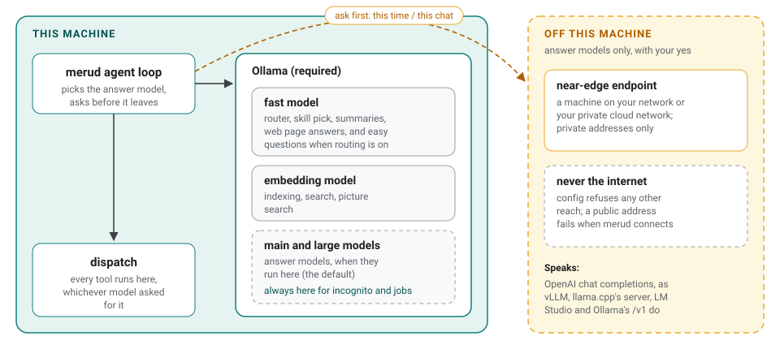
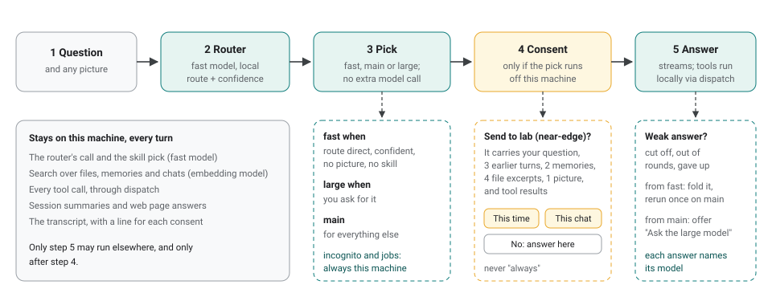

# A model router, and answer models on other machines

*High-level design. Status: built: the endpoint engine, local and near-edge reach, the consent question, and the model pick. Issue: [#78](https://github.com/aarora79/meru/issues/78). Milestone: v0.7.*

Today the main model writes every answer, even "what is 2 + 2?", and it must run in Ollama on this machine. This design changes both. The router, which already reads each question with the fast model, also picks which model answers: the fast model for easy questions, the main model for the rest, and an optional large model for questions that go wrong or that you send there. And an answer model can run on another model server: on this machine, or on a machine on your own network. Meru asks before a chat sends anything off the machine, and sends nothing to the internet.

[ARCHITECTURE.md](../../ARCHITECTURE.md) holds the contract. This page explains the design from end to end.

## What stays and what may move



Meru uses three kinds of model:

| Model | Does | Runs |
| --- | --- | --- |
| fast | routes each question, picks a skill, summarizes chats, answers questions about a fetched web page, and with routing on, answers easy questions | Ollama on this machine, always |
| embedding | indexes files and pictures, and turns each search into numbers | Ollama on this machine, always |
| main, and an optional large | write answers, calling tools as they go | Ollama on this machine by default, or an endpoint you name |

The fast model stays here because the router reads the probability of each possible first word, which only a local Ollama reports. The embedding model stays here because indexing reads every file in your folders, and search reads every question. Keeping both here means routing, search and summaries never send your files, chats or pictures anywhere.

Only the answer turn may leave, and it carries a lot. A turn's prompt holds your question, recent turns of the chat, your profile and recalled memories, excerpts from your files, any picture you attached, and the result of each tool the model calls. The consent prompt names each of these.

## Endpoints

An endpoint is an answer model that isn't on the local Ollama. You name it in `config.toml`; Meru ships no provider's address. Every endpoint speaks the OpenAI chat completions API.

```toml
[[endpoints]]
name           = "lab"
reach          = "near-edge"             # local or near-edge
url            = "http://10.0.0.5:8000/v1"
api_key        = "secret:lab_key"        # optional; the key lives in secrets.toml
model          = "my-70b"
context_length = 131072
vision         = false

[models]
main  = "qwen3.6:35b"   # a local model
large = "@lab"          # or an endpoint, by name
```

**Reach** says how far a request may travel, and `merud` checks the address it connects to, not the name in the URL:

- `local`: this machine only. Use it for a second server on this Mac, or for Ollama's own OpenAI-style API.
- `near-edge`: private addresses only, such as a GPU box on your network or a server in your own private cloud network.

Config refuses any other reach, so no endpoint sits on the internet. No redirect may take a request to another host.

**One API.** Meru talks to every endpoint through the OpenAI chat completions API (`POST <url>/chat/completions`), which most model servers speak: vLLM, llama.cpp's server, LM Studio and Ollama's `/v1`. It takes pictures and tool calls. It doesn't report a model's context length, so the endpoint states it.

**The key** goes in `~/.meru/secrets.toml`, never in `config.toml`. `merud` keeps it out of every log, span, error message and transcript. A missing key leaves `merud` running, with the endpoint marked broken in Settings.

Only `main` and `large` may name an endpoint. Config refuses `fast = "@lab"` and `embed = "@lab"`.

## One turn



1. **The router reads the question** on the fast model, as it does today, and returns a route (`direct`, `search`, `tools`, `search+tools`) and how sure it is.
2. **Meru picks the answer model** from that result, with no extra model call. With `[router] answers = "routed"`:
   - **fast** when the route is `direct`, the router is at least `easy_above` sure (0.8 by default), the question asks for no facts, and it has no picture and no skill. A question that ends with a question mark, or opens with a question word or a command such as "tell", "explain" or "list", asks for facts. The owner added this rule on 2 November 2026, after the fast model answered "Nara" for the capital of Japan;
   - **large** when you ask for it: "Ask the large model" in Meru.app, `/large` in `meru chat`, or `meru -large`;
   - **main** for everything else.

   With `answers = "main"`, the default until the benchmark says otherwise, main answers every question, as today.
3. **Meru asks before a turn leaves.** If the pick runs at `near-edge`, and this chat has no yes on record, the client shows a card:

   > **Send this question to lab (near-edge)?**
   > It carries your question, 3 earlier turns, 2 memories, 4 file excerpts and 1 picture, and the results of any tools this turn runs.
   > [This time] [This chat] [No]

   - **This time** sends this turn.
   - **This chat** sends this turn and the rest of this chat until `merud` restarts.
   - **No** answers on this machine instead, and the answer says so.

   No choice means "always". An incognito chat and a scheduled job never leave: they answer on this machine without asking. `meru run --json` sees the card as an approval event and answers no, so a script's turns stay here.
4. **The answer streams** from the picked model. Every tool it calls runs on this machine through `dispatch`, with the same allowlists and approvals as today. The prompt is sized for the picked model's context window.
5. **A weak answer moves up one model.** If the fast model's answer runs out of room, uses every tool round, gives up or breaks a tool call, Meru folds that answer into a collapsed block you can open, and asks main, once. If main's answer ends that way and a large model is set, the answer offers "Ask the large model", which asks for consent first if that model runs near-edge.
6. **Each answer names its model,** and an answer from an endpoint names its reach: "Answered by lab (near-edge)".

## What you can see afterwards

- The transcript records each consent, with the endpoint, its reach and your choice, but no prompt text.
- `/usage by model` and the Usage screen list endpoint answers by name, such as `@lab`.
- `merud`'s metrics carry a `meru.reach` attribute (local or near-edge) on each model call, so `/metrics` shows how many answers left the machine and how long they took. Rate limits and timeouts count as their own outcomes.

## The rule this changes

Meru's first rule said no code path sends a prompt to a cloud model. The owner decided on 1 November 2026 to change it, knowingly, and on 2 November 2026 dropped the `remote` reach and the Anthropic engine, which narrowed it to:

> **No prompt goes to the internet, and none leaves the machine without your yes.** The fast model, the embedding model and everything they do run on Ollama on this machine. Only an answer model may run on another server, on an endpoint you name in config, on this machine or your own network. A turn goes near-edge only after you approve it: this time or this chat, never always. An incognito chat and a job never leave. The code holds no provider's address and no provider's SDK, and never sends to Ollama's cloud models.

What still holds:

- The policy tests still refuse a provider's host name and a provider's SDK in the code. You type every URL.
- Ollama's cloud models stay refused ([#211](https://github.com/aarora79/meru/issues/211)): they would leave the machine through the local Ollama, with no consent card.
- No telemetry leaves the machine, apart from the anonymous daily usage report that [#251](https://github.com/aarora79/meru/issues/251) added later.
- With no `[[endpoints]]` in config, nothing changes: every model runs here.

The same pull request that changes the code carries the rule into AGENTS.md, ARCHITECTURE.md, the architecture pages, the README, the landing page, the slides and the posters.

## How it's built

One new engine, `OpenAIEngine`, sits beside the Ollama engine in `internal/engine`, behind the same four-method `Engine` interface, and speaks the OpenAI chat completions API. It reads its server's stream of events with the standard library, joins tool calls that arrive in pieces, and drops the model's reasoning text from the answer. It doesn't embed; the embedding model never leaves Ollama. No new module joins `go.mod`.

The agent loop gains a small step that picks the answer model, and a consent step that rides the channel tool approvals already use, so all three clients and `meru run --json` get it.

The work ships in three pull requests, each usable alone:

1. **The engine, at local reach only.** `[[endpoints]]` with `reach = "local"`, the OpenAI engine, and `@name` for main and large. Tested against fakes and against Ollama's own `/v1`. No rule changes, since nothing leaves the machine yet.
2. **Reach and consent.** `near-edge`, the address check, the consent card in every client, incognito and jobs kept here, and the rule change in every document. Tested by hand against an OpenAI-style server on another machine on the network, first from a Meru home with no memories, profile or folders.
3. **The router picks.** `answers = "routed"`, fast answers for easy questions, moving up on a weak answer, and "Ask the large model". The benchmark's routed set decides `easy_above` and whether `routed` becomes the default: the pass rate must hold and the median time to first token must drop.

## What it doesn't do

- Run the fast or embedding model anywhere but this machine.
- Remember a yes past the chat, or past a restart of `merud`.
- Send an incognito chat or a job off the machine.
- Choose the large model up front from a "hard question" score. That waits for an eval set that shows a score works.
- Send only part of a prompt off the machine, such as the question without your memories.
- Send a prompt to the internet, or offer a reach that does.
- Speak any API but OpenAI chat completions, or ship a list of providers.

## Related

- [ARCHITECTURE.md](../../ARCHITECTURE.md): "Principles", "Model tiers", "Engine layer", "Privacy boundary" and "Deliberate non-goals".
- [docs/fast-router.md](../fast-router.md): how the one-token router works.
- [docs/benchmarks/README.md](../benchmarks/README.md): the benchmark the router is measured on.
